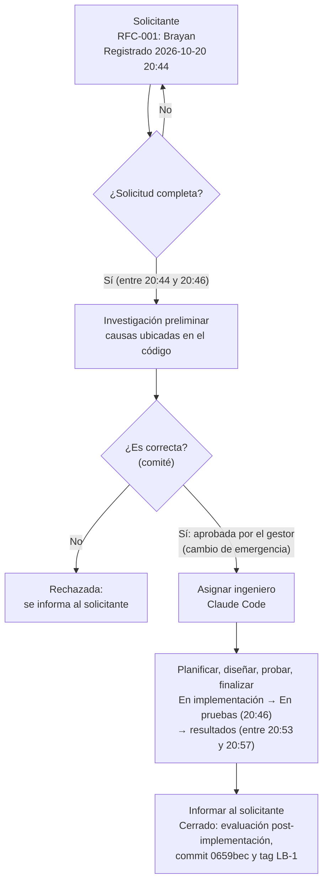

# Guía para la presentación

Para el grupo que expone. Condiciones del profesor: **una lámina por punto** (el punto 12 puede tener varias), **exponen todos los integrantes** y **8 minutos en total**. Cada fila dice qué archivo abrir, qué poner en la lámina y qué decir.

## Reparto de tiempo sugerido (8 minutos = 480 s)

| # | Punto | Tiempo |
|---|---|---|
| 1 | Descripción del proyecto | 0:40 |
| 2 | Diagnóstico del software inicial | 0:45 |
| 3 | Pasos y diagramas de ingeniería inversa | 0:50 |
| 4 | Refactorización DRY | 0:35 |
| 5 | Refactorización Responsabilidad Única | 0:35 |
| 6 | Refactorización Abierto/Cerrado | 0:35 |
| 7 | Refactorización Inversión de Control | 0:35 |
| 8 | Resultados del mantenimiento y refactorización | 0:50 |
| 9 | Elementos de configuración | 0:30 |
| 10 | Ejemplo de solicitud de cambio (RFC) | 0:40 |
| 11 | Flujo de aprobación del cambio | 0:40 |
| 12 | Pantallas del sistema | 0:45 |
| | **Total** | **8:00** |

Como exponen todos, conviene que cada integrante tome un bloque seguido de puntos (por ejemplo 1–3, 4–7, 8–9, 10–12) para no perder tiempo en los cambios de expositor. La cantidad de integrantes no está en el repositorio: ajusten los bloques al tamaño del grupo. Ensayen con cronómetro; los puntos 4 a 7 se pueden acortar si el tiempo no alcanza, porque comparten la misma idea.

## Los 12 puntos

| # | Punto | Archivo de `docs/` | Qué poner en la lámina | Frases clave para el expositor |
|---|---|---|---|---|
| 1 | Descripción del proyecto | `README.md`, `entrega/PANTALLAS.md` | Captura 01 (selección de rol); tecnologías: Angular, Spring Boot, MySQL; los 3 roles y qué hace cada uno | "Es un sistema de citas para la Posta Médica Valdiviezo, con tres roles: paciente, médico y administrador." "Lo recibimos sin documentación, con errores y con código difícil de mantener; nuestro trabajo fue mantenerlo y refactorizarlo sin romperlo." |
| 2 | Diagnóstico del software inicial | `HALLAZGOS.md`, `PRUEBAS.md` (resumen LB-0) | Totales por gravedad y tipo (`entrega/RESULTADOS.md`, sección 2) y 3 ejemplos críticos: clave `123456` que dejaba entrar a cualquiera (H-001), módulo médico con datos inventados (H-004), doble reserva (H-012) | "Encontramos 39 problemas, 7 críticos; cada uno con archivo, línea y evidencia." "En la línea base inicial solo pasaban 7 de 17 pruebas." |
| 3 | Pasos y diagramas de ingeniería inversa | `entrega/INGENIERIA_INVERSA.md` | Los 5 pasos (tabla) y los 3 diagramas en miniatura: ER (datos), clases por capas (lógica), mapa de pantallas (interfaces) | "Reconstruimos el diseño a partir del código y de la base de datos, porque no había documentación." "Con análisis estático leímos el código; con análisis dinámico lo ejecutamos y vimos qué fallaba." |
| 4 | Diagrama de refactorización aplicando DRY | `rfc/RFC-005.md` (sección "Diagrama de clases (UML)", antes LB-4 / después LB-5) | Diagrama antes/después: 3 logins con la lógica copiada → 3 logins que usan `login-comun.ts`; CORS de 13 controladores → un solo lugar | "DRY significa no te repitas: la misma lógica estaba copiada en 3 logins y el CORS en 13 controladores." "Ahora un cambio de login se hace en un archivo y no en tres." |
| 5 | Diagrama de refactorización aplicando Responsabilidad Única | `rfc/RFC-006.md` (antes LB-5 / después LB-6) | Diagrama antes/después: la pantalla "Registrar Cita" calculaba los horarios → la regla pasa a `horarios-cita.ts` | "Cada clase debe tener un solo motivo para cambiar." "La pantalla ya no decide qué horas están libres: solo las muestra; la regla está aparte y se prueba sola." |
| 6 | Diagrama de refactorización aplicando Abierto/Cerrado | `rfc/RFC-007.md` (antes LB-6 / después LB-7) | Diagrama antes/después: `AuthController` con un `if` por rol → interfaz `AutenticadorRol` con una clase por rol | "Abierto para extender, cerrado para modificar." "Para agregar un rol nuevo, por ejemplo recepcionista, se crea una clase y el controlador no se toca." |
| 7 | Diagrama de refactorización aplicando Inversión de Control | `rfc/RFC-008.md` (antes LB-7 / después LB-8) | Diagrama antes/después: controladores con `@Autowired` sobre clases concretas → constructor y dependencia de interfaces (`ICitaService`…) | "Los controladores ya no crean ni eligen sus dependencias: Spring se las entrega por el constructor." "Dependen de interfaces, así que se pueden cambiar o simular en las pruebas." `@Autowired` pasó de 15 a 0. |
| 8 | Resultados del mantenimiento y refactorización | `entrega/RESULTADOS.md` | Tabla de pruebas por línea base (LB-0 a LB-8) y tabla de métricas antes/después; si cabe, el gitGraph | "De 7 pruebas que pasaban llegamos a 20 de 25; las unitarias pasaron de 0 a 49 en el frontend y de 4 a 50 en el backend." "Las 5 que fallan son errores que una refactorización no debe corregir, y siguen fallando igual: eso prueba que no cambiamos el comportamiento." |
| 9 | Elementos de configuración del proyecto | `ELEMENTOS_CONFIGURACION.md` | Tabla resumida de EC-01 a EC-18: código, scripts, configuración, documentación y herramientas con su versión | "Identificamos cada pieza que controlamos: código, base de datos, configuración, documentos y herramientas con su versión." "Cada cambio queda en una línea base con tag de Git, de LB-0 a LB-8." |
| 10 | Ejemplo de solicitud de cambio (RFC) | `rfc/RFC-001.md` (y `rfc/RFC-002.md` como contraste) | Ficha de RFC-001: identificador, hallazgos H-001 a H-003, tipo **Emergencia**, prioridad Alta, solicitante, gestor, impacto, plan de back-out, línea base LB-0 → LB-1. Al costado: RFC-002, tipo **Normal** | "RFC-001 fue un cambio de emergencia: el login dejaba entrar a cualquiera con la clave 123456, así que lo aprobó el gestor del cambio sin esperar al comité." "RFC-002 es un cambio normal: lo aprobó el comité de control de configuración." |
| 11 | Flujo de aprobación del cambio | `rfc/RFC-001.md` (Historial de estados) | Diagrama del flujo (abajo) con los estados de RFC-001 al lado de cada paso | "Ningún código se tocó antes de que la RFC estuviera aprobada y asignada." "Cada paso quedó registrado con su hora en el historial de la RFC." |
| 12 | Pantallas del sistema | `entrega/PANTALLAS.md` | Varias láminas: (a) selección de rol y login; (b) paciente: registrar cita y mis citas; (c) médico: citas pendientes con Aceptar/Cancelar; (d) admin: reportes | "Estas pantallas son de la versión final, LB-8, con los datos reales de la base." "El módulo del médico ya muestra citas reales que se pueden aceptar o cancelar." |

## Punto 10: RFC-001 frente a RFC-002

| Campo | RFC-001 (ejemplo principal) | RFC-002 (contraste) |
|---|---|---|
| Tipo de cambio | Emergencia (falla de seguridad de alto impacto) | Normal |
| Hallazgos | H-001, H-002, H-003 | H-028 |
| Quién aprueba | Brayan, gestor del cambio, sin esperar al comité completo | Comité de control de configuración (Brayan, en representación del grupo) |
| Línea base | LB-0 → LB-1 | LB-1 → LB-2 |
| Resultado | P07, P08, P10 y P17 pasan de FALLA a PASA | P19 nueva, pasa |

## Punto 11: flujo de aprobación del curso, ilustrado con RFC-001

| Paso del flujo del curso | Estado en el historial de RFC-001 | Hora registrada |
|---|---|---|
| Solicitante | Registrado (solicitante: Brayan) | 2026-10-20 20:44 |
| ¿Solicitud completa? | ¿Solicitud completa? → Sí | entre 20:44 y 20:46 |
| Investigación preliminar | Investigación preliminar | entre 20:44 y 20:46 |
| ¿Es correcta? (comité) | ¿Es correcta? → Sí; Aprobado (por el gestor del cambio, por ser de emergencia) | entre 20:44 y 20:46 |
| Asignar ingeniero | Asignado (Claude Code) | entre 20:44 y 20:46 |
| Planificar, diseñar, probar, finalizar | En implementación → En pruebas → En pruebas → resultados | 20:46; resultados entre 20:53 y 20:57 |
| Informar al solicitante | Cerrado (evaluación post-implementación, commit y tag LB-1) | entre 20:54 y 20:57 |

Notas para el expositor:
- En un cambio **normal** la decisión "¿es correcta?" la toma el comité (así se aprobó RFC-002). En RFC-001, por ser de **emergencia**, la aprobó el gestor del cambio sin esperar al comité completo.
- El historial de RFC-001 no tiene un estado propio llamado "Informar al solicitante": esa comunicación es el cierre (evaluación post-implementación y reporte). Si el profesor pregunta, decirlo así.
- Varias horas de RFC-001 son rangos ("entre 20:44 y 20:46") porque se corrigieron horas que se habían estimado (bitácora, entrada "Corrección de horas" del 2026-10-21). Es un buen ejemplo de por qué la bitácora registra solo horas reales.

## Preguntas probables del profesor

**1. ¿Por qué la refactorización no corrigió la doble reserva?**
Porque refactorizar no cambia el comportamiento externo; solo mejora la estructura interna. La doble reserva (H-012) es un error de comportamiento: corregirlo es mantenimiento correctivo y necesita su propia RFC. Por eso P13 sigue fallando igual en LB-4 a LB-8, y eso prueba que las refactorizaciones no alteraron nada.

**2. ¿Qué diferencia hay entre RFC-001 y RFC-002?**
Las dos son correctivas y tocan los logins. RFC-001 es de **emergencia**: corrigió el atajo de la clave `123456` (H-001), la sesión que no se borraba al salir (H-002) y los mensajes distintos (H-003), y la aprobó el gestor del cambio. RFC-002 es **normal**: corrigió que el login de paciente no comprobaba el rol (H-028), y la aprobó el comité.

**3. ¿Qué es una línea base y cuáles tienen?**
Es una versión aprobada y congelada del sistema que sirve de referencia para los cambios siguientes. Tenemos 9, cada una con un tag anotado de Git: LB-0 (estado inicial), LB-1 a LB-3 (correcciones RFC-001 a 003), LB-4 (reorganización), LB-5 a LB-8 (refactorizaciones DRY, SRP, OCP, IoC).

**4. ¿Cómo saben que una refactorización no cambió el comportamiento?**
Porque corrimos la batería completa antes y después y comparamos las salidas con `diff`: en LB-4 a LB-8 dieron lo mismo. Además, las pruebas unitarias de caracterización siguieron pasando sin modificar sus aserciones.

**5. ¿Qué tipos de mantenimiento aplicaron?**
Correctivo (RFC-001, 002 y 003: errores que ya ocurrían) y preventivo (RFC-004 a 008: reorganización y refactorizaciones que mejoran la mantenibilidad). No hubo adaptativo ni perfectivo.

**6. ¿Qué es la ingeniería inversa y por qué la necesitaban?**
Es reconstruir el diseño de un sistema a partir del producto ya hecho. Recibimos solo el código y la base de datos, sin diagramas. Hicimos ingeniería inversa de datos (diagrama ER), de lógica (diagrama de clases) y de interfaces (mapa de pantallas).

**7. ¿Qué es un elemento de configuración?**
Cualquier pieza que se controla y versiona: el código del backend y del frontend, el script de la base, los archivos de configuración, la documentación, las pruebas y las herramientas con su versión (JDK, Node, MySQL, Angular, Git). Tenemos 18, de EC-01 a EC-18.

**8. ¿Qué es una prueba de regresión?**
Volver a ejecutar todas las pruebas después de un cambio para comprobar que no se rompió nada de lo que funcionaba. Corrimos la batería completa (P01–P25, más las unitarias y las de Playwright) en cada línea base.

**9. ¿Qué pasa si un cambio sale mal?**
Cada RFC tiene un plan de back-out: volver a la línea base anterior con su tag de Git. No hizo falta usarlo en ninguna RFC; quedó registrado en la evaluación post-implementación de cada una.

**10. ¿Qué harían a continuación?**
Abrir RFC correctivas para los 4 pendientes críticos: autenticación en la API (H-016), que las pantallas pidan solo los datos del paciente (H-013), contraseñas cifradas (H-007) y validar la doble reserva en el backend (H-012).
