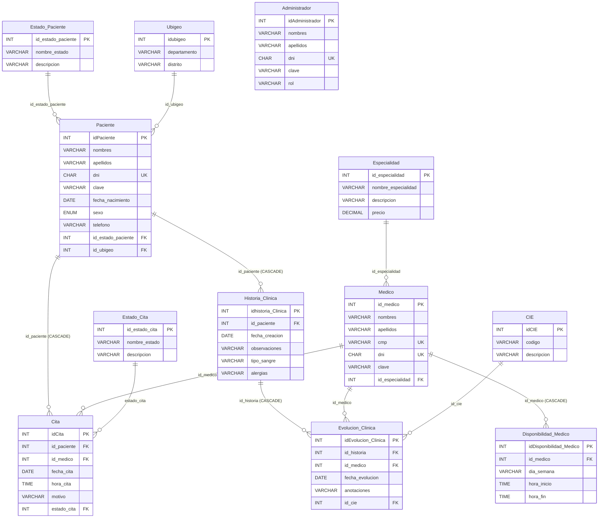
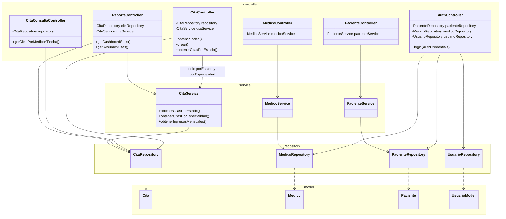
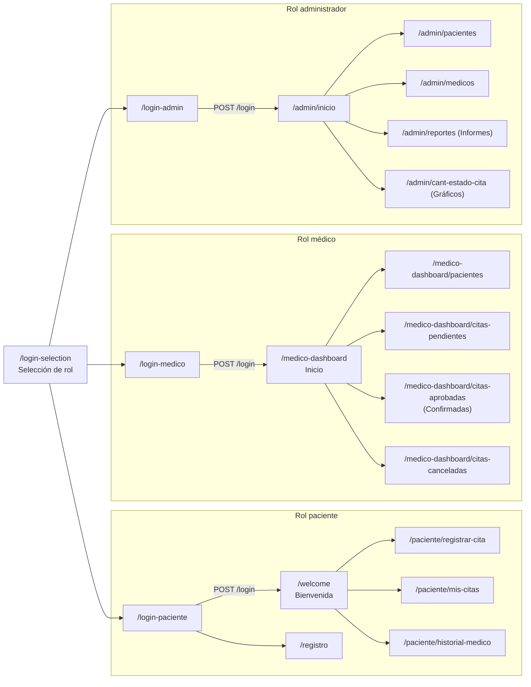

# Ingeniería inversa del sistema "Posta Médica Valdiviezo" (punto 3)

El sistema se recibió sin documentación de diseño: solo el código (Angular 20 + Spring Boot + MySQL) y el script `BDPostaMedica.sql`. Para poder mantenerlo había que reconstruir primero **qué hace y cómo está hecho**. Se siguieron los 5 pasos de la ingeniería inversa del curso. Cada paso remite a la entrada de `docs/BITACORA.md` donde quedó registrado.

| Paso | Qué se hizo en este proyecto | Dónde está registrado |
|---|---|---|
| 1. Comprender el producto | Se instaló y se puso en marcha tal como se recibió: commit inicial `17e2118`, creación de la BD con `BDPostaMedica.sql` (12 tablas, 21 citas), arranque del backend (8080) y del frontend (4200). Se identificaron los 3 roles (paciente, médico, administrador) y lo que cada uno puede hacer. | Bitácora 2026-10-20 19:12 – 19:17 |
| 2. Desmontaje | Se separó el sistema en sus piezas: 12 tablas del SQL, 14 controladores, 11 repositorios + 1 de usuarios, 4 servicios y 12 entidades del backend; 20 rutas y sus componentes en el frontend. Se inventariaron los elementos de configuración (EC-01 a EC-17). | `docs/ELEMENTOS_CONFIGURACION.md`; bitácora 2026-10-20 20:00 |
| 3. Análisis | Análisis **estático** (lectura del código y `grep`) y **dinámico** (ejecución con `curl` y Playwright). Resultado: 26 hallazgos el primer día (H-001 a H-026), 39 al final. | `docs/HALLAZGOS.md`; bitácora 2026-10-20 19:17 – 20:37 |
| 4. Reconstrucción | Con lo aprendido se reconstruyeron los modelos de datos, lógica e interfaces (los 3 diagramas de abajo) y se planificaron los cambios: 3 RFC correctivas, 1 reorganización y 4 refactorizaciones (RFC-001 a RFC-008). | Este documento; `docs/rfc/` |
| 5. Pruebas | Se creó una batería de pruebas (P01–P25), pruebas unitarias de caracterización (U01–U84) y 6 pruebas E2E de Playwright. Se ejecutaron en cada línea base (LB-0 a LB-8) como prueba de regresión. | `docs/PRUEBAS.md`; `docs/entrega/RESULTADOS.md` |

## Análisis estático y dinámico

**Análisis estático** (sin ejecutar el programa): lectura del código y búsquedas con `grep` / `git grep`. Ejemplos reales:
- `grep -rn "@Autowired"` → 15 inyecciones por campo (H-020).
- `grep -rn "@CrossOrigin"` → 13 controladores con CORS repetido y distinto (H-010).
- Lectura de `login-paciente.component.ts` → atajo con la clave `123456` que dejaba entrar como el paciente 1 (H-001).
- Lectura de `WebSecurityConfig.java` → `anyRequest().permitAll()`, la API no exige autenticación (H-016).
- Comparación de los 3 componentes de login → lógica copiada (H-008).

**Análisis dinámico** (ejecutando el sistema):
- `curl` a todos los GET de los 14 controladores: todo responde 200 salvo `GET /api/medico/resumenMedico` → 500 (H-005).
- Playwright: se abrieron las 20 rutas y se hizo login por formulario con los 3 roles; se vio que las claves de sesión cambian según el rol y que cerrar sesión no borra nada (H-002).
- Módulo médico con el backend **apagado**: seguía mostrando las mismas citas → los datos estaban escritos en el código (H-004).
- Dos reservas al mismo médico, fecha y hora: el sistema aceptó las dos (H-012, doble reserva).
- Registro de red de "Mis Citas": el navegador recibe las citas de todos los pacientes y filtra (H-013).

## 1. Ingeniería inversa de DATOS: modelo entidad-relación (SQL de LB-0)

Obtenido de `git show LB-0:BDPostaMedica.sql` (sentencias `CREATE TABLE`, `PRIMARY KEY`, `FOREIGN KEY`). 12 tablas. `Administrador` no tiene relaciones.

Lo que el modelo de datos reveló:
- `Cita` no tiene una restricción única (médico, fecha, hora): la base permite la doble reserva (H-012).
- `Cita` no guarda el precio: los ingresos se calculan con el precio **actual** de `Especialidad` (H-024).
- `clave` se guarda en texto plano en `Paciente`, `Medico` y `Administrador` (H-007).
- El esquema no cambió entre LB-0 y LB-8 (solo se movió el archivo a `database/` en LB-4).

## 2. Ingeniería inversa de LÓGICA: diagrama de clases por capas

Obtenido del paquete `com.centro_valdiviezo.backend` en LB-0 (`git show LB-0:backend/backend/src/main/java/...`). Solo las clases principales; los 7 controladores de catálogo (CIE, Ubigeo, Estado_Cita, etc.) siguen el mismo patrón controlador → repositorio y se omiten.

Lo que el diagrama de lógica reveló:
- Las capas existen, pero se saltan: varios controladores van directo al repositorio sin pasar por un servicio (H-015, H-039). `CitaController` usa `CitaService` solo para 2 consultas agregadas; el CRUD de citas (`obtenerTodos`, `crear`, `actualizar`, `eliminar`) va directo a `CitaRepository`.
- `AuthController` conoce los 3 repositorios y tiene un bloque `if` por rol: agregar un rol obliga a modificarlo (H-019).
- Todas las dependencias son por campo (`@Autowired`) y hacia clases concretas, no interfaces (H-020).

**Cómo quedó en LB-8** (resultado de las refactorizaciones; detalle y diagramas antes/después en `docs/rfc/RFC-007.md` y `RFC-008.md`):
- `AuthController` recibe `List<AutenticadorRol>`; cada rol es una clase (`AutenticadorPaciente`, `AutenticadorMedico`, `AutenticadorAdministrador`) (RFC-007, R3).
- `CitaController` y `CitaConsultaController` dependen de la interfaz `ICitaService`; existen también `IMedicoService`, `IPacienteService`, `IUsuarioService`; todas las dependencias por constructor (RFC-008, R4).

## 3. Ingeniería inversa de INTERFACES: mapa de pantallas por rol

Obtenido de `app.routes.ts` y de las llamadas HTTP de cada componente y servicio (`grep` de `http.get/post/put/delete` y de `appsettings.apiUrl`). El mapa muestra las rutas de LB-8; son las mismas que en LB-0 (RFC-004 movió archivos pero no cambió rutas). La única diferencia de endpoints es el módulo médico: en LB-0 **no llamaba a ningún endpoint** (datos escritos en el código, H-004); desde LB-3 (RFC-003) llama a `/api/citas/medico/...`.

| Pantalla (ruta) | Endpoints que llama |
|---|---|
| `/login-paciente`, `/login-medico`, `/login-admin` | `POST /login` |
| `/registro` | `POST /api/paciente/crear` |
| `/welcome` | ninguno (solo cierra sesión en el navegador) |
| `/paciente/registrar-cita` | `GET /api/especialidad`, `GET /api/medico/especialidad/{id}`, `GET /api/disponibilidad_medico/medico/{id}`, `GET /api/citas/medico/{id}/fecha/{fecha}`, `POST /api/cita` |
| `/paciente/mis-citas` | `GET /api/cita` (todas, H-013), `GET /api/medico/codigo/{id}` y `GET /api/especialidad/{id}` por cada cita (H-014), `DELETE /api/cita/{id}` |
| `/paciente/historial-medico` | `GET /api/historia_clinica` (todas, H-013), `GET /api/evolucion_clinica`, `GET /api/medico/codigo/{id}`, `GET /api/cie/{id}` |
| `/medico-dashboard` (inicio) | ninguno |
| `/medico-dashboard/citas-pendientes`, `citas-aprobadas`, `citas-canceladas` | `GET /api/citas/medico/{id}?estado=...`; pendientes además `PUT /api/citas/medico/{id}/{idCita}/estado` (desde LB-3; en LB-0 ninguno) |
| `/medico-dashboard/pacientes` | `GET /api/citas/medico/{id}/pacientes` (desde LB-3; en LB-0 ninguno) |
| `/admin/inicio` | ninguno (texto fijo) |
| `/admin/pacientes` | `GET /api/paciente`, `PUT /api/paciente/actualizar/{id}`, `DELETE /api/paciente/eliminar/{id}` |
| `/admin/medicos` | `GET /api/medico/conEspecialidad` |
| `/admin/reportes` | `GET /api/reportes/dashboard`, `GET /api/reportes/resumen` |
| `/admin/cant-estado-cita` | `GET /api/cita/porEstado`, `GET /api/cita/porEspecialidad`, `GET /api/reportes/ingresosMensuales` |

Rutas que existen pero ningún menú enlaza: `/medico` y `/gestion-pacientes-legacy` (H-035).

Lo que el mapa de interfaces reveló:
- Las pantallas del paciente piden **todos** los datos y filtran en el navegador (H-013).
- El módulo médico no estaba conectado al backend (H-004, corregido en RFC-003).
- La API no pide token: cualquiera que conozca estas URL puede usarlas sin iniciar sesión (H-016).
