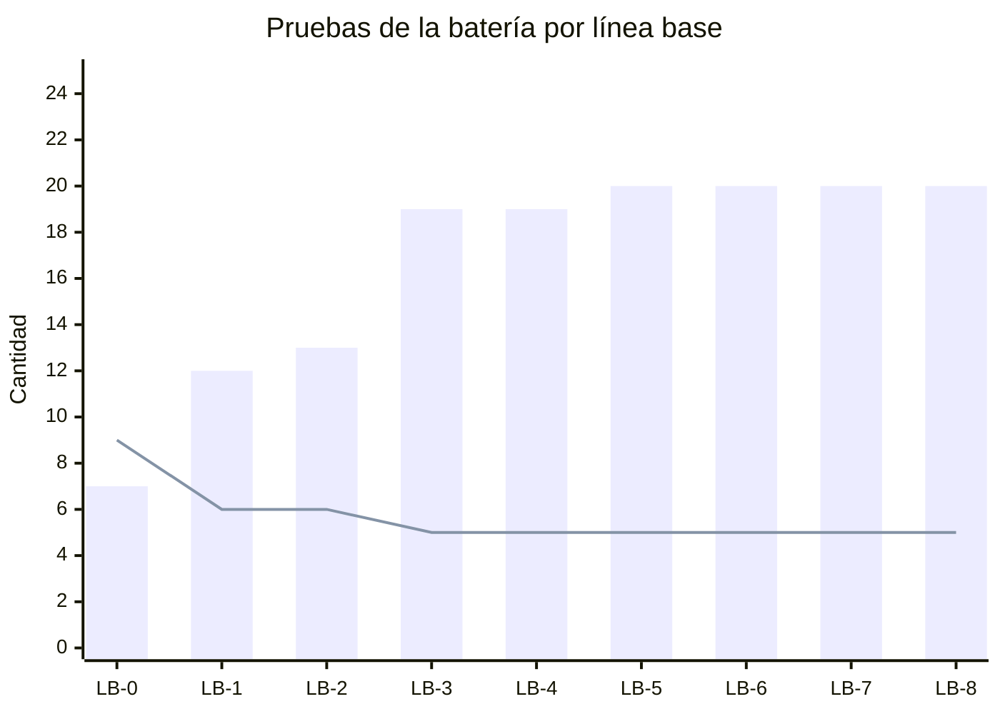
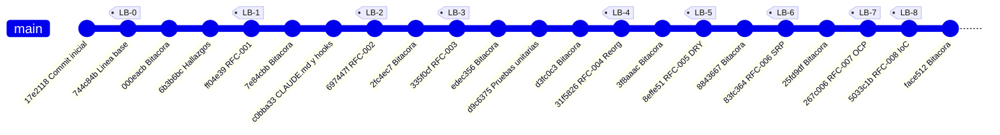

# Resultados (punto 8)

Fuentes: `docs/PRUEBAS.md` (tabla de resultados y resúmenes por línea base), `docs/HALLAZGOS.md` y comandos ejecutados el 2026-10-21 a las 16:36 sobre los tags de Git `LB-0` y `LB-8`.

## 1. Evolución de las pruebas de la batería (P01–P25) por línea base

| Línea base | Cambio | Pruebas en la batería | PASA | FALLA | Qué cambió |
|---|---|---|---|---|---|
| LB-0 | Estado inicial | 17 (P01–P17) | 7 | 9 (+1 mixta: P08) | — |
| LB-1 | RFC-001 (correctivo: login y sesión) | 18 (+P18) | 12 | 6 | P07, P08, P10, P17 pasan a PASA; P18 nueva |
| LB-2 | RFC-002 (correctivo: rol en login de paciente) | 19 (+P19) | 13 | 6 | P19 nueva, pasa |
| LB-3 | RFC-003 (correctivo: módulo médico con datos reales) | 24 (+P20–P24) | 19 | 5 | P11 pasa a PASA; P20–P24 nuevas, pasan |
| LB-4 | RFC-004 (reorganización de carpetas) | 24 | 19 | 5 | Nada (igual a LB-3) |
| LB-5 | RFC-005 (R1 DRY) | 25 (+P25) | 20 | 5 | Nada; P25 nueva (medida antes del cambio) |
| LB-6 | RFC-006 (R2 SRP) | 25 | 20 | 5 | Nada |
| LB-7 | RFC-007 (R3 Abierto/Cerrado) | 25 | 20 | 5 | Nada |
| LB-8 | RFC-008 (R4 Inversión de Control) | 25 | 20 | 5 | Nada |

Las 5 que siguen fallando en LB-8 son **P04** (H-005), **P13** (doble reserva, H-012), **P14**, **P15** y **P16** (H-013). Son errores correctivos sin RFC: por regla del curso, las refactorizaciones (LB-4 a LB-8) no los corrigen y deben seguir fallando igual. Eso se cumplió: en LB-4 a LB-8 ningún resultado cambió.


(Barras = PASA; línea = FALLA. En LB-0 la prueba mixta P08 no se cuenta en ninguna.)

## 2. Hallazgos

39 hallazgos registrados al cerrar LB-8 (H-001 a H-039); las tablas de abajo cuentan esos 39. En la tarea 13 se agregaron H-040 y H-041 (Baja, Preventivo), que eran errores de redacción de `HALLAZGOS.md`, no del sistema; ya están "Cerrado (corrección de documentación)". Con ellos el total es 41, con 20 cerrados y 21 pendientes (los pendientes no cambian). Conteo hecho sobre la tabla de `docs/HALLAZGOS.md` con `awk` (columnas Gravedad, Tipo y Estado). Nota: al hacer este conteo, la fila de H-027 tenía un `|` sin escapar y `awk` la leía desplazada; se contó a mano como "Cerrado (RFC-004, LB-4)". Ese error (H-040) ya se corrigió.

### Por gravedad

| Gravedad | Total | Cerrados | Pendientes |
|---|---|---|---|
| Crítica | 7 | 3 | 4 |
| Alta | 5 | 1 | 4 |
| Media | 8 | 5 | 3 (uno parcial: H-023) |
| Baja | 19 | 9 | 10 |
| **Total** | **39** | **18** | **21** |

### Por tipo de mantenimiento

| Tipo | Total | Cerrados | Pendientes |
|---|---|---|---|
| Correctivo | 16 | 4 | 12 |
| Preventivo | 23 | 14 | 9 (uno parcial: H-023) |
| Adaptativo | 0 | 0 | 0 |
| Perfectivo | 0 | 0 | 0 |

Lectura: la mayor parte del trabajo cerró hallazgos **preventivos** (estructura y principios de diseño: R1–R4 y la reorganización). De los correctivos se cerraron los 4 que tenían RFC (H-001, H-002, H-004, H-028).

### Pendientes críticos

| ID | Problema | Por qué sigue abierto |
|---|---|---|
| H-007 | Contraseñas en texto plano en la BD y devueltas por la API | Requiere cambiar BD, login y API: RFC correctivo no planificado |
| H-012 | Doble reserva (mismo médico, fecha y hora) | Correctivo sin RFC; ninguna refactorización lo corrige (P13 sigue fallando) |
| H-013 | El frontend descarga datos de todos los pacientes y filtra en el navegador | Requiere endpoints por paciente; depende de H-016 |
| H-016 | La API no exige autenticación (`permitAll`) | Requiere activar JWT y cambiar el frontend: cambio grande fuera del alcance |

## 3. Pruebas unitarias: al inicio y al final

| | Inicio (LB-0) | Final (LB-8) |
|---|---|---|
| Frontend | 15 archivos `.spec.ts` generados por Angular; **0 se ejecutan** (4 no compilan y hacen fallar toda la compilación de `ng test`, H-033) | **49** que pasan: 32 de caracterización (U01–U32) + 17 unitarias de funciones extraídas (U63–U79) |
| Backend | 3 clases de prueba viejas con **4 pruebas** (`contextLoads`, `AuthControllerTest`, `EspecialidadTest` ×2) | **50** que pasan (`Tests run: 50, Failures: 0, Errors: 0`): las 4 viejas + caracterización U33–U62 + U80–U84 |
| E2E (Playwright) | 6 archivos en `tests/`; su resultado en LB-0 no se midió (Sin registro) | 6 que pasan (`6 passed`, carpeta `e2e/tests/`) |

Comandos usados para contar los archivos (2026-10-21 16:36):
```bash
git ls-tree -r --name-only LB-0 | grep -E "\.spec\.ts$" | cut -d/ -f1 | sort | uniq -c
#      15 proyecto_valdiviezo
#       6 tests
git ls-tree -r --name-only LB-0 | grep -E "src/test/.*\.java$"
# 3 archivos: CentroValdiviezoApplicationTests, AuthControllerTest, EspecialidadTest
git ls-tree -r --name-only LB-8 | grep -cE "(caracterizacion|unitaria)\.spec\.ts$"
# 8
git ls-tree -r --name-only LB-8 | grep -E "src/test/.*\.java$" | wc -l
# 13
```
Las 4 pruebas viejas del backend se contaron al ejecutarlas en la tarea 9 sobre LB-3; `git diff --stat LB-0 LB-3 -- backend/backend/src/test` no muestra cambios, así que son las mismas de LB-0. En LB-0 no se ejecutaron (Sin registro del resultado en esa fecha). Los números de pruebas ejecutadas (49, 50, 6) son los registrados en la validación de RFC-008 (bitácora 2026-10-21 16:14–16:19; `docs/PRUEBAS.md`, "Resultados de LB-8"). En esta tarea no se volvieron a ejecutar porque no se cambió código.

## 4. Métricas simples: LB-0 contra LB-8

| Métrica | LB-0 | LB-8 | Comentario |
|---|---|---|---|
| Líneas de los 3 componentes de login | 220 (76 + 72 + 72) | 161 (55 + 54 + 52) + 60 de `login-comun.ts` = 221 | El total es casi igual, pero la lógica común ya no está copiada 3 veces: un cambio de login se hace en 1 archivo y no en 3 (R1 DRY) |
| `@Autowired` en el código del backend | 15 | 0 | Inyección por constructor (R4 IoC) |
| `@CrossOrigin` en el backend | 13 | 0 | CORS en un solo lugar, `WebSecurityConfig` (R1 DRY) |
| Clases con nombre repetido en el frontend | 5 | 3 | Se eliminaron los logins huérfanos (RFC-004); quedan `LoginSelectionComponent`, `RegistroComponent`, `WelcomeComponent` (H-034) |
| Archivos en el código del frontend (`src/`) | 135 | 133 | Se eliminaron huérfanos y se agregaron pruebas y archivos extraídos |

Comandos usados (ejecutados el 2026-10-21 a las 16:36, en Git Bash, sobre los tags; salida pegada):

```bash
# Líneas de los 3 logins
for f in login-paciente login-medico login-admin; do git show LB-0:proyecto_valdiviezo/src/app/$f/$f.component.ts | wc -l; done
# 76 72 72
for f in login-paciente login-medico login-admin; do git show LB-8:frontend/src/app/features/auth/$f/$f.component.ts | wc -l; done
# 55 54 52
git show LB-8:frontend/src/app/features/auth/login-comun.ts | wc -l
# 60

# @Autowired
git grep -c "@Autowired" LB-0 -- 'backend/backend/src/main' | awk -F: '{s+=$NF} END {print s}'
# 15
git grep -c "@Autowired" LB-8 -- backend/src/main ; echo "exit=$?"
# (sin salida) exit=1  -> 0 coincidencias

# @CrossOrigin
git grep -c "@CrossOrigin" LB-0 -- 'backend/backend/src/main' | awk -F: '{s+=$NF} END {print s}'
# 13
git grep -c "@CrossOrigin" LB-8 -- backend/src/main ; echo "exit=$?"
# (sin salida) exit=1  -> 0 coincidencias

# Clases repetidas (duplicados)
git grep -h "export class" LB-0 -- 'proyecto_valdiviezo/src/app/*.ts' ':!*.spec.ts' | awk '{print $3}' | sort | uniq -d
# LoginAdminComponent LoginPacienteComponent LoginSelectionComponent RegistroComponent WelcomeComponent
git grep -h "export class" LB-8 -- 'frontend/src/app/*.ts' ':!*.spec.ts' | awk '{print $3}' | sort | uniq -d
# LoginSelectionComponent RegistroComponent WelcomeComponent

# Archivos del frontend
git ls-tree -r --name-only LB-0 -- proyecto_valdiviezo/src | wc -l   # 135
git ls-tree -r --name-only LB-8 -- frontend/src | wc -l             # 133
```

**Archivos huérfanos:** no hay un comando único que los detecte; se identificaron con `git grep` de cada nombre de clase y archivo (método en RFC-004). En LB-4 se eliminaron los huérfanos aprobados (H-009, H-021, H-026, H-027: 2 logins viejos, `UsuariosComponent`, `WebConfig.java`, `prueba.java` y sus archivos asociados; lista exacta en `docs/rfc/RFC-004.md`). En LB-8 quedan los de H-034 (pendiente: decide el usuario).

## 5. Grafo de evolución de las líneas base

Generado a partir de `git log --oneline --reverse --decorate=short`. Una sola rama (`master`); cada línea base es un tag anotado. Los commits "Bitacora: registrar hash..." registran el hash del commit anterior (un commit no puede contener su propio hash).


