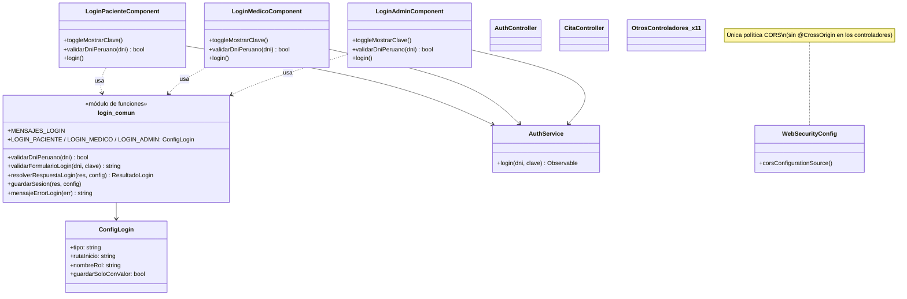

# RFC-005 — R1 DRY: lógica de login y CORS en un solo lugar

| Campo | Valor |
|---|---|
| **Identificador** | RFC-005 |
| **Fecha de recepción** | 2026-10-21 14:55 |
| **Error conocido asociado** | H-008, H-010, H-030 — ver `docs/HALLAZGOS.md` |
| **Tipo de cambio** | Normal |
| **Prioridad** | Media |
| **Tipo de mantenimiento** | Preventivo |
| **Solicitante** | Brayan |
| **Gestor del cambio / aprobación** | Comité de control de configuración (Brayan) |
| **Ingeniero asignado** | Claude Code |
| **Línea base de partida** | LB-4 (commit `31f5826`, tag `LB-4`; el último commit es `3f8aaac`, que solo agrega documentación) |
| **Línea base resultante** | LB-5 (tag `LB-5`) |
| **Estatus** | Cerrado |

**Regla que enmarca la RFC:** es una refactorización (mantenimiento preventivo). **No cambia el comportamiento.** Todas las pruebas deben dar el mismo resultado que en LB-4 (P01–P24, P25 nueva, unitarias 32/32 y 37/37, Playwright 6/6) y las pantallas de login deben verse idénticas. Las pruebas de caracterización (`*.caracterizacion.spec.ts`) no se modifican y los constructores de los componentes no cambian.

---

## Principio aplicado: DRY ("Don't Repeat Yourself", no te repitas)

**Qué dice, en simple:** cada pieza de conocimiento del sistema debe estar escrita en **un solo lugar**. "Conocimiento" no es solo código: es una regla ("el DNI tiene 8 dígitos"), un texto ("Credenciales inválidas") o una decisión ("qué claves se guardan en la sesión"). Si la misma regla está copiada en tres archivos, cambiarla obliga a acordarse de los tres; cuando alguien se olvida de uno, los roles empiezan a comportarse distinto. Eso es exactamente lo que pasó en este proyecto: H-002 (claves de sesión distintas por rol) y H-003 (mensajes distintos por rol) nacieron de la copia (H-008), y H-030 es una diferencia más que quedó entre las copias.

**Cómo se aplicó aquí:**
- **Frontend (H-008, H-030):** la validación del DNI, la validación del formulario, los textos de los mensajes, la decisión sobre la respuesta del servidor (rol correcto, rol equivocado, respuesta sin `success`), el guardado de la sesión y la lectura del error (401 o conexión) pasan a un solo archivo, `frontend/src/app/features/auth/login-comun.ts`, como **funciones puras y constantes** parametrizadas por rol. Los 3 componentes quedan como clases delgadas: mismo nombre, mismos campos, mismo constructor y mismos métodos públicos (`toggleMostrarClave`, `validarDniPeruano`, `login`); cada método delega en las funciones comunes.
- **Backend (H-010):** la política CORS ya está escrita, global, en `WebSecurityConfig.corsConfigurationSource()`. Las 13 anotaciones `@CrossOrigin` repetían (con otros valores) algo que ya decidía esa configuración. Se eliminan: la política queda en un solo lugar.

---

## Descripción del cambio

### Motivación (qué pasa hoy)
- **H-008:** `login-paciente.component.ts`, `login-medico.component.ts` y `login-admin.component.ts` repiten `validarDniPeruano`, la validación del formulario, los 5 textos de error, la comprobación del rol, el guardado de `userId`/`userName`/`userType` y el manejo del error. Las copias ya divergieron en detalles (ver "Diferencias entre las copias").
- **H-030:** ante una respuesta 200 sin `success`, admin muestra "Credenciales incorrectas" y paciente/médico "Respuesta inesperada del servidor".
- **H-010:** 13 controladores tienen `@CrossOrigin` (12 con `origins = "*"`, `AuthController` con `http://localhost:4200`); `UsuarioController` y `ReporteController` no tienen.

### Propósito (qué debe pasar después)
- Un solo lugar para la lógica de login (`login-comun.ts`) y un solo lugar para la política CORS (`WebSecurityConfig`).
- Mismo comportamiento observable: mismas pantallas, mensajes, claves de sesión, navegación y respuestas CORS.

---

## Diseño

### 1) Diferencias entre las copias y qué se hace con cada una

Antes de unificar se compararon las 3 copias línea por línea. Cada diferencia se clasificó: si **puede ocurrir** con este backend, se conserva (parametrizada por rol); si es **inalcanzable**, se unifica y se deja la evidencia.

| # | Diferencia | ¿Puede ocurrir? | Decisión |
|---|---|---|---|
| D1 | Respuesta 200 sin `success` (H-030): admin "Credenciales incorrectas"; paciente/médico "Respuesta inesperada del servidor" | **No** (evidencia en la sección 2) | Se unifica en "Respuesta inesperada del servidor" |
| D2 | Respuesta 200 con cuerpo `null`: paciente/médico comprueban `res && res.success` (muestran "Respuesta inesperada…"); admin lee `response.success` sin comprobar (lanzaría `TypeError` dentro del `subscribe`) | **No**: `AuthController` responde siempre con un `Map` como cuerpo; no hay otro manejador de `/login` | Se unifica con la comprobación `res && res.success` |
| D3 | Guardado de la sesión: paciente/médico guardan cada clave solo si el campo tiene valor (`if (res.id)`, `if (res.nombres)`, `if (res.tipo)`); admin guarda las 3 siempre | **Sí**, en un caso: un usuario con `nombres` vacío (`''`). La columna es `NOT NULL` pero admite `''`, y `POST /api/paciente/crear`, `POST /api/medico/crear` y `POST /usuarios/nuevo` aceptan cualquier valor sin autenticación (H-016). Con `nombres = ''`, paciente/médico **no** guardan `userName`; admin guarda `" Apellidos"`. (`id` nunca es 0: es `AUTO_INCREMENT`; `tipo` siempre lo pone el backend) | **Se conserva** la diferencia: cada rol declara en su configuración `guardarSoloConValor` (paciente y médico `true`, admin `false`). Se registra como hallazgo H-036 para que se decida aparte |
| D4 | `console.log`/`console.error` distintos (paciente/médico escriben "Intentando login…" y "Login exitoso"; admin no; el texto del error es "Error login" o "Error en login:") | Sí (consola del navegador) | Se conservan en cada componente, sin cambios |
| D5 | Condición `if (this.dni && this.clave)` después de validar | Siempre verdadera: si el DNI pasó `^\d{8}$` no está vacío, y si la clave estaba vacía ya se salió con el mensaje | Se elimina la condición redundante (no cambia nada) |

### 2) H-030: ¿puede llegar una respuesta 200 sin `success`?
Comprobado en el código del backend (2026-10-21 14:5x, sobre LB-4):
- El frontend llama solo a `http://localhost:8080/login` (`core/services/auth.ts:9`).
- `grep -rn '"/login"\|setFilterProcessesUrl' backend/src/main` → solo `AuthController.java:35` (`@PostMapping("/login")`) y una línea **comentada** de `WebSecurityConfig.java:36` (el filtro JWT que también procesaría `/login` está desactivado).
- `AuthController.login` tiene 6 `return`: 400 (faltan datos), 3 × `ResponseEntity.ok(response)` con `response.put("success", true)` justo antes (líneas 51, 67, 84), 401 y 500. **Toda respuesta 200 lleva `success: true`.** Las 400/401/500 van a la rama `error` del `subscribe`, no a `next`.
- La seguridad permite todo (`anyRequest().permitAll()`, H-016) y no hay `formLogin` ni otro filtro que responda `/login`.

**Conclusión:** con este backend la rama "200 sin `success`" es **inalcanzable**. Se unifica en el mensaje de paciente y médico, "Respuesta inesperada del servidor", porque describe lo que pasó (el servidor respondió algo que no se esperaba); "Credenciales incorrectas" sería falso: las credenciales incorrectas llegan como 401.

### 3) Archivo nuevo `frontend/src/app/features/auth/login-comun.ts`
Funciones puras y constantes, sin Angular:

| Elemento | Qué hace |
|---|---|
| `MENSAJES_LOGIN` | Los textos: DNI inválido, contraseña vacía, credenciales inválidas, sin conexión, respuesta inesperada |
| `ConfigLogin`, `LOGIN_PACIENTE`, `LOGIN_MEDICO`, `LOGIN_ADMIN` | Por rol: `tipo` que debe devolver el backend, `rutaInicio`, nombre para el mensaje de rol ("un paciente", "un médico", "un administrador") y `guardarSoloConValor` (D3) |
| `validarDniPeruano(dni)` | `^\d{8}$` |
| `validarFormularioLogin(dni, clave)` | Devuelve el mensaje de error o `''` |
| `mensajeRolEquivocado(config)` | "Este usuario no es {un paciente…}. Use el login que le corresponde." |
| `resolverRespuestaLogin(res, config)` | `{ ruta }` si el rol es el correcto, `{ error }` si no o si falta `success` |
| `guardarSesion(res, config)` | Escribe `userId`, `userName` ("nombres apellidos") y `userType` en `localStorage` según `guardarSoloConValor` |
| `mensajeErrorLogin(err)` | 401 → "Credenciales inválidas"; cualquier otro → mensaje de conexión (comportamiento actual, H-029 sigue abierto) |

Los componentes conservan: los campos (`dni`/`usuario`, `clave`, `mostrarClave`, `error`), el constructor `(AuthService, Router)`, `toggleMostrarClave()`, `validarDniPeruano()` (delega) y `login()` (llama a `AuthService.login`, delega las decisiones y navega con `Router`). Plantillas y CSS no cambian.

### 4) Backend: las 13 anotaciones `@CrossOrigin`
Se quitan la anotación y su `import` de: `AuthController`, `CIEController`, `CitaConsultaController`, `CitaController`, `Disponibilidad_MedicoController`, `EspecialidadController`, `Estado_CitaController`, `Estado_PacienteController`, `Evolucion_ClinicaController`, `Historia_ClinicaController`, `MedicoController`, `PacienteController`, `UbigeoController` (solo `AuthController` y `CitaConsultaController` importan `CrossOrigin` por nombre; los otros 11 usan `import org.springframework.web.bind.annotation.*;` y no tienen `import` que quitar).

**Por qué no cambia el comportamiento (y por qué hoy no tienen efecto):** Spring Security ejecuta su `CorsFilter` con `corsConfigurationSource()` **antes** de llegar al controlador. Una petición preflight válida se responde en ese filtro, y una de un origen no permitido se rechaza ahí con 403 "Invalid CORS request"; en las peticiones normales el filtro ya pone `Access-Control-Allow-Origin` y el procesador CORS de Spring MVC no hace nada si la cabecera ya está. Por eso hoy `origins = "*"` no deja pasar a un origen ajeno. Se comprueba con P25 antes y después.

**P25 en LB-4 (antes del cambio, 14:53):** preflight desde `http://localhost:4200` → 200 con `Access-Control-Allow-Origin: http://localhost:4200`, `Allow-Methods: GET,POST,PUT,DELETE,OPTIONS`, `Allow-Credentials: true`; desde `http://otro-origen.example` → 403 `Invalid CORS request`, también en controladores con `origins = "*"` y en `/usuarios` (sin anotación). Evidencia: `docs/evidencias/lb4-P25-cors.txt`.

### 5) Pruebas nuevas
- **P25 — CORS** (Integración) en `docs/PRUEBAS.md`.
- **Unitarias nuevas** de las funciones extraídas: `frontend/src/app/features/auth/login-comun.unitaria.spec.ts` (U63 en adelante). Se compilan con un tsconfig nuevo, `frontend/tsconfig.unitarias.json`, que incluye los `*.caracterizacion.spec.ts` y los `*.unitaria.spec.ts`; el comando de las 32 de caracterización **no cambia** y se corre igual que en LB-4.

---

## Diagrama de clases (UML)

### Antes (LB-4)
```mermaid
classDiagram
    class LoginPacienteComponent {
        +dni: string
        +clave: string
        +error: string
        +toggleMostrarClave()
        +validarDniPeruano(dni) bool
        +login()
    }
    class LoginMedicoComponent {
        +dni: string
        +clave: string
        +error: string
        +toggleMostrarClave()
        +validarDniPeruano(dni) bool
        +login()
    }
    class LoginAdminComponent {
        +usuario: string
        +clave: string
        +error: string
        +toggleMostrarClave()
        +validarDniPeruano(dni) bool
        +login()
    }
    class AuthService {
        +login(dni, clave) Observable
    }
    LoginPacienteComponent --> AuthService
    LoginMedicoComponent --> AuthService
    LoginAdminComponent --> AuthService
    note for LoginPacienteComponent "Cada login copia: regex del DNI,\nmensajes, chequeo de rol,\nlocalStorage y manejo de 401"

    class WebSecurityConfig {
        +corsConfigurationSource()
    }
    class AuthController {
        <<@CrossOrigin localhost:4200>>
    }
    class CitaController {
        <<@CrossOrigin *>>
    }
    class OtrosControladores_x11 {
        <<@CrossOrigin *>>
    }
```

### Después (LB-5)


---

## Alternativas evaluadas

| Alternativa | Decisión | Motivo |
|---|---|---|
| Funciones puras y constantes en `features/auth/login-comun.ts` | **Elegida** | Los componentes conservan su constructor `(AuthService, Router)`, así las pruebas de caracterización siguen funcionando sin tocarlas; las funciones se prueban sin Angular. |
| Clase base `LoginBaseComponent` con herencia | Descartada | Obliga a llamar `super(...)` y a mover campos a la base; una plantilla distinta por rol (`usuario` vs `dni`) complica la herencia. La tarea pide no cambiar los constructores. |
| Un servicio Angular inyectable (`LoginFlowService`) | Descartada | Cambiaría el constructor de los 3 componentes (un parámetro más) y las pruebas de caracterización, que crean los componentes con `new X(auth, router)`, dejarían de compilar. |
| Un solo componente de login con el rol por parámetro de ruta | Descartada | Cambia rutas, plantillas y nombres de clase: no es una refactorización. |
| Unificar también el guardado de sesión (D3) | Descartada | Cambiaría el comportamiento en un caso alcanzable (`nombres` vacío). Se conserva parametrizado y se registra H-036. |
| Unificar el mensaje de H-030 en "Credenciales incorrectas" | Descartada | El texto sería falso (las credenciales incorrectas llegan como 401) y lo usa solo 1 de 3 copias. |
| Mover el CORS a `WebMvcConfigurer.addCorsMappings` | Descartada | Agregaría un segundo lugar; la configuración de Spring Security ya es la que manda. |
| Corregir H-029 (mensaje de conexión ante un 500) al unificar | Descartada | Es correctivo y cambia el comportamiento; sigue abierto para una RFC propia. |

---

## Análisis de impacto

### Técnico — archivos
- **Nuevos:** `frontend/src/app/features/auth/login-comun.ts`, `frontend/src/app/features/auth/login-comun.unitaria.spec.ts`, `frontend/tsconfig.unitarias.json`, evidencias `docs/evidencias/lb4-P25-cors.txt`, `lb5-*`.
- **Modificados:** los 3 `login-*.component.ts` (solo el `.ts`); 13 controladores del backend (una anotación y, en 2, su `import`).
- **Sin cambios:** plantillas, CSS, rutas, `AuthService`, `WebSecurityConfig`, pruebas existentes.

### Costo y tiempo estimado
- Código: 30 min. Validación (build, unitarias, `mvnw test`, Playwright, P01–P25, capturas): 1 h. Documentación: 30 min. Costo monetario: ninguno.

### Recursos humanos
- Comité de control de configuración (Brayan): aprobación.
- Ingeniero asignado: Claude Code.

### Riesgo — qué podría romperse y cómo se detectaría
| Riesgo | Cómo se detecta |
|---|---|
| Un mensaje o una clave de sesión cambia en algún rol | U01–U18 (caracterización), P05–P10, P17–P19, capturas antes/después |
| Cambia la navegación tras el login | U01, U07, U13; P05–P07 |
| Quitar `@CrossOrigin` cambia el CORS | P25 antes/después; P01–P24 (el frontend llama al backend desde otro origen) |
| Advertencias nuevas de compilación | `ng build --configuration development` |

## Personas afectadas
Desarrolladores (la lógica de login está en un archivo nuevo). Usuarios finales: ninguno (sin cambio de comportamiento).

## Plan de implementación
| Orden | Paso | Responsable |
|---|---|---|
| 1 | Registrar la RFC y flujo hasta "Asignado" | Comité / Claude Code |
| 2 | Capturas "antes" de las pantallas de login y P25 en LB-4 | Claude Code |
| 3 | `login-comun.ts` y los 3 componentes; pruebas unitarias nuevas | Claude Code |
| 4 | Quitar las 13 `@CrossOrigin`; reiniciar el backend; P25 | Claude Code |
| 5 | `ng build`, unitarias, `mvnw test`, Playwright, BD recargada, P01–P25, capturas "después" | Claude Code |
| 6 | Evaluación, documentación, commit y tag `LB-5` | Claude Code / Comité |

## Plan de back-out
- Antes del commit: `git restore --source=HEAD -- frontend backend` y quitar los archivos nuevos con la herramienta de edición.
- Después del commit: `git revert --no-edit <hash del commit RFC-005>`. Se reinicia el backend y se corre la batería para confirmar los resultados de LB-4.

---

## Historial de estados

| Fecha y hora | Estado | Qué se hizo |
|---|---|---|
| 2026-10-21 14:55 | Registrado | Se registró la RFC-005 tras comparar las 3 copias del login, revisar `AuthController` y `WebSecurityConfig` y correr P25 en LB-4 (14:53). |
| 2026-10-21 14:55 | ¿Solicitud completa? → Sí | Tiene todos los campos del formato, el diseño, las diferencias entre copias con su decisión, los diagramas y las alternativas. |
| 2026-10-21 14:55 | Investigación preliminar | H-030 inalcanzable (sección 2). Se encontró una diferencia alcanzable (D3, `nombres` vacío) que se conserva. P25 muestra que las `@CrossOrigin` hoy no tienen efecto. |
| 2026-10-21 14:55 | ¿Es correcta? → Sí | No cambia el comportamiento, no cambia constructores ni pruebas de caracterización, no corrige hallazgos correctivos. |
| 2026-10-21 14:55 | Aprobado | Aprobado por el Comité de control de configuración (Brayan), según la solicitud de la tarea 11. |
| 2026-10-21 14:55 | Asignado | Asignado a Claude Code. |
| 2026-10-21 14:55 | En implementación | Capturas "antes" (14:48–14:52) y P25 en LB-4 (14:53) ya tomadas. `login-comun.ts`, los 3 componentes, las pruebas U63–U71 y `tsconfig.unitarias.json` escritos entre 14:55 y 14:57; las 13 `@CrossOrigin` quitadas a las 14:57. |
| 2026-10-21 14:58 | En pruebas | `ng build` (14:58), unitarias del frontend (14:58), backend detenido (14:59:23), BD recargada (14:59:34), `mvnw test` (14:59:35), backend reiniciado (15:00:13), P25 (15:00:19), Playwright (15:00:50), capturas "después" (15:01:04–15:01:53, más 2 corridas de control sin hora de fin registrada), BD recargada (15:05:35) y batería P01–P24 entre 15:05 y 15:08. |
| 2026-10-21 15:08 | En pruebas → resultados | Todo igual a LB-4: P01–P24 iguales, P25 idéntica byte a byte, 32/32 (+9 nuevas, 41/41) y 37/37, Playwright 6/6, capturas idénticas. Detalle en `docs/PRUEBAS.md`, "Resultados de LB-5". |
| 2026-10-21 15:11 | Cerrado | Evaluación post-implementación completada; H-008, H-010 y H-030 cerrados; H-036 registrado. El commit y el tag `LB-5` se registran en la bitácora. |

---

## Evaluación post-implementación

### ¿Se cumplieron los objetivos?
Sí. La lógica de login y la política CORS quedaron en un solo lugar y **el comportamiento no cambió**:

| Objetivo | Evidencia | LB-4 | LB-5 |
|---|---|---|---|
| Lógica de login en un solo lugar (H-008) | `login-comun.ts`; los 3 componentes delegan | 3 copias (≈50 líneas cada una) | 1 archivo de funciones; componentes de ≈20 líneas de lógica |
| H-030 resuelto con evidencia | Sección 2; U68 | 2 mensajes distintos para una rama inalcanzable | Un solo mensaje |
| CORS en un solo lugar (H-010) | `grep -rn "@CrossOrigin" backend/src` → sin resultados; P25 | 13 anotaciones + configuración global | Solo la configuración global; P25 idéntica |
| Mismos constructores y pruebas de caracterización intactas | `git diff` de los `*.caracterizacion.spec.ts`: vacío | 32/32 | 32/32 |
| Sin cambio de comportamiento | P01–P24, Playwright, capturas | 19 PASA · 5 FALLA | 19 PASA · 5 FALLA (+ P25 PASA), **las 24 iguales** |
| Pruebas nuevas | U63–U71, P25 | — | 9/9 pasan; P25 pasa |

### ¿Hubo problemas imprevistos?
- **Una diferencia entre las copias era alcanzable (D3, H-036):** el guardado de `userName` con `nombres` vacío. Unificarla habría cambiado el comportamiento de un rol, así que se conservó como parámetro de configuración por rol y se registró H-036 para una RFC correctiva.
- **Las capturas no eran deterministas:** la primera corrida "antes" cambiaba entre repeticiones por las transiciones CSS de 0.3 s. Se ajustó el script (sin foco, mouse fuera, `animations: 'disabled'`) y se volvió a capturar "antes" sobre LB-4. Quedó un ruido de 7–18 píxeles en los bordes de la caja del login de admin que aparece igual entre corridas del mismo código; para cada caso hay un par LB-4 / LB-5 idéntico (`docs/evidencias/lb5-capturas-comparacion.txt`).
- **H-010 estaba descrito de forma incompleta:** decía que la configuración CORS era "distinta" por controlador, pero P25 mostró que las anotaciones no tenían efecto (manda `WebSecurityConfig`). Se agregó la precisión en `HALLAZGOS.md`.

### ¿Se usó el plan de back-out? ¿Por qué?
No. Los objetivos se cumplieron y no hubo regresiones.
