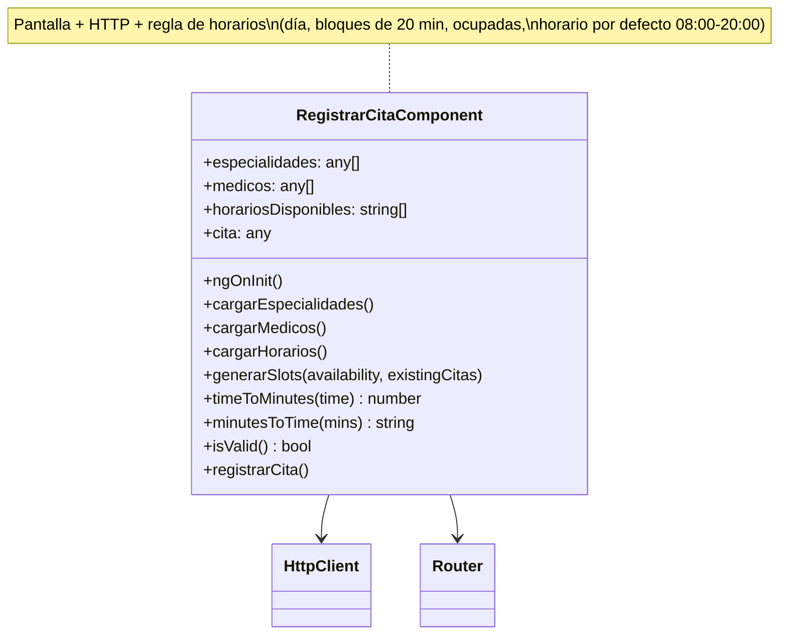
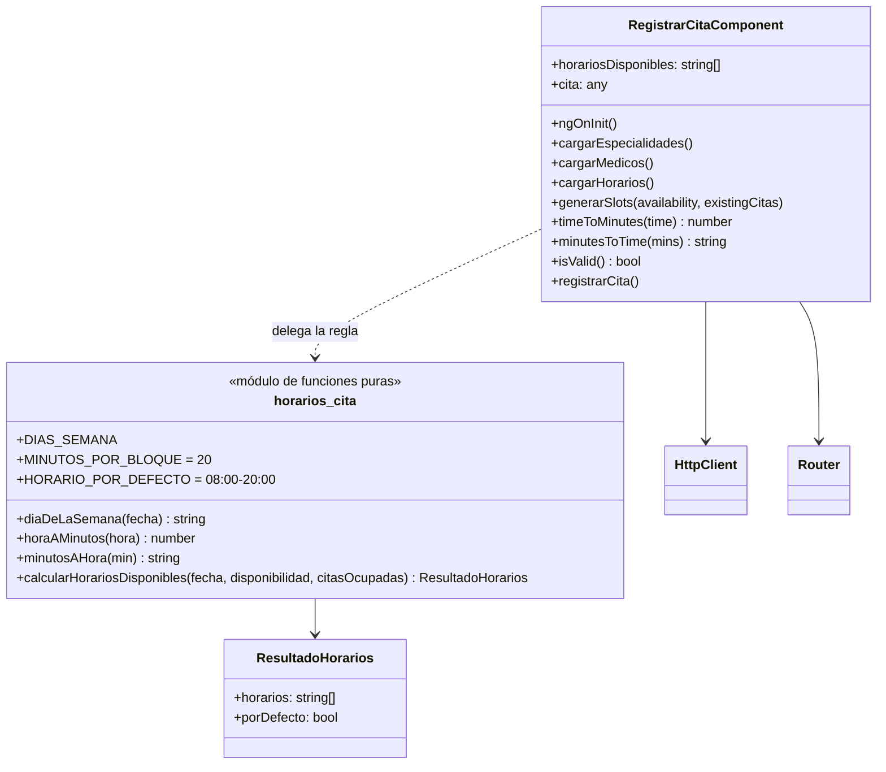

# RFC-006 — R2 SRP: regla de horarios separada de la pantalla

| Campo | Valor |
|---|---|
| **Identificador** | RFC-006 |
| **Fecha de recepción** | 2026-10-21 15:16 |
| **Error conocido asociado** | H-018 — ver `docs/HALLAZGOS.md` |
| **Tipo de cambio** | Normal |
| **Prioridad** | Media |
| **Tipo de mantenimiento** | Preventivo |
| **Solicitante** | Brayan |
| **Gestor del cambio / aprobación** | Comité de control de configuración (Brayan) |
| **Ingeniero asignado** | Claude Code |
| **Línea base de partida** | LB-5 (commit `8effe51`, tag `LB-5`; el último commit es `8843667`, que solo agrega documentación) |
| **Línea base resultante** | LB-6 (tag `LB-6`) |
| **Estatus** | Cerrado |

**Regla que enmarca la RFC:** es una refactorización (mantenimiento preventivo). **No cambia el comportamiento**, tampoco la regla de negocio: el horario por defecto de 08:00 a 20:00 cuando el médico no tiene horario ese día (H-022) **se conserva**; H-022 sigue abierto y se corregirá con una RFC correctiva aparte. Todas las pruebas deben dar igual que en LB-5 y la pantalla "Registrar Cita" debe verse idéntica. `registrar-cita.caracterizacion.spec.ts` (U19–U23) no se modifica y el constructor del componente no cambia.

---

## Principio aplicado: Responsabilidad Única (SRP, "Single Responsibility Principle")

**Qué dice, en simple:** una clase (o un módulo) debe tener **una sola razón para cambiar**. Si una clase cambia cuando cambia la pantalla y también cuando cambia una regla del negocio, tiene dos responsabilidades mezcladas: cada cambio en una arriesga romper la otra, y la regla no se puede probar ni reutilizar sin arrastrar la pantalla.

**Cómo se aplicó aquí:** `RegistrarCitaComponent` tenía dos razones para cambiar:
1. **La pantalla:** el formulario, las listas de especialidades y médicos, las llamadas HTTP, el guardado de la cita y la navegación.
2. **La regla de negocio de horarios:** qué día de la semana es la fecha, qué horario tiene el médico ese día, bloques de 20 minutos, qué horas están ocupadas y qué hacer si no hay horario (horario por defecto).

La regla pasa a su propio archivo, `frontend/src/app/features/paciente/registrar-cita/horarios-cita.ts`, como **funciones puras** (reciben datos y devuelven datos; no usan Angular, HTTP ni el estado del componente). El componente conserva `generarSlots()` (y `timeToMinutes()` / `minutesToTime()`, que son públicos) y solo delega: pasa la fecha, la disponibilidad y las citas ocupadas, y guarda la lista que recibe. Cuando se corrija H-022, el cambio se hará en `horarios-cita.ts` y la pantalla no se tocará.

---

## Descripción del cambio

### Motivación (qué pasa hoy)
- **H-018:** `generarSlots()` (`registrar-cita.component.ts:71-109`) decide el día, busca la regla de disponibilidad, arma bloques de 20 minutos, descarta los ocupados y aplica el horario por defecto, dentro del mismo componente que maneja el formulario y el HTTP. `timeToMinutes` y `minutesToTime` (`:111-121`) son utilidades de la regla.

### Propósito (qué debe pasar después)
- La regla de horarios en un archivo propio, con una función pura que recibe fecha, disponibilidad y citas ocupadas y devuelve los horarios.
- El componente solo maneja la pantalla; `generarSlots()` delega.
- Mismo resultado para cualquier entrada (incluidos los casos raros, ver la sección 2).

---

## Diseño

### 1) Archivo nuevo `horarios-cita.ts`

| Elemento | Qué hace |
|---|---|
| `DIAS_SEMANA` | `['Domingo', 'Lunes', …, 'Sábado']`, en el orden de `Date.getDay()` |
| `MINUTOS_POR_BLOQUE` | 20 |
| `HORARIO_POR_DEFECTO` | `{ inicio: '08:00', fin: '20:00' }` — se aplica si no hay horario ese día o si todo está ocupado (H-022, se conserva) |
| `diaDeLaSemana(fecha)` | `'2026-10-26'` → `'Lunes'` (con `T00:00:00`, hora local, igual que antes) |
| `horaAMinutos(hora)` / `minutosAHora(min)` | Lo que hacían `timeToMinutes` / `minutesToTime` |
| `calcularHorariosDisponibles(fecha, disponibilidad, citasOcupadas)` | Devuelve `{ horarios: string[], porDefecto: boolean }`: la lista de horarios y si se usó el horario por defecto |

**Por qué devuelve también `porDefecto`:** el componente escribe en la consola "Using fallback availability." cuando se usa el horario por defecto. Para conservar ese mensaje sin repetir la regla en el componente, la función informa si lo usó. La lista de horarios es `horarios`.

El componente queda así (esquema):
```ts
generarSlots(availability, existingCitas) {
  console.log('Checking availability for:', diaDeLaSemana(this.cita.fecha_cita));
  this.horariosDisponibles = [];   // como antes: si el cálculo falla, la lista queda vacía
  const resultado = calcularHorariosDisponibles(this.cita.fecha_cita, availability, existingCitas);
  if (resultado.porDefecto) console.log('Using fallback availability.');
  this.horariosDisponibles = resultado.horarios;
}
timeToMinutes(t) { return horaAMinutos(t); }
minutesToTime(m) { return minutosAHora(m); }
```

### 2) Detalles del código actual que se conservan tal cual
| Detalle | ¿Puede ocurrir? | Decisión |
|---|---|---|
| Con horario, la comparación usa `c.hora_cita.substring(0,5)` **sin** comprobar nulo (una cita con `hora_cita` nula lanza `TypeError`); en el horario por defecto se comprueba (`c.hora_cita && …`) | **Sí**: `Cita.hora_cita` es `TIME` sin `NOT NULL` (`database/BDPostaMedica.sql:125`) y `POST /api/cita` guarda cualquier cuerpo (H-012, H-016) | Se conserva la asimetría. Se registra como hallazgo H-037 para que se corrija aparte |
| Estado de la lista si se lanza ese `TypeError` | — | Antes: la lista se vaciaba y la excepción salía antes del primer `push` (para agregar un bloque, `find` tiene que recorrer todas las citas, y así llega a la nula). Después: el componente vacía la lista antes de llamar a la función; si lanza, queda vacía. Mismo estado |
| Orden de los mensajes de consola ("Checking…" antes de calcular, "Using fallback…" si corresponde) | Sí (consola) | Se conserva |
| `timeToMinutes('')`/`undefined` devuelve 0 | Sí (horario sin `hora_inicio`) | Se conserva en `horaAMinutos` |
| Fecha inválida: `getDay()` da `NaN`, el día es `undefined` y busca una regla con `dia_semana` indefinido | Sí (`fecha_cita` viene del input) | Se conserva (misma expresión) |

### 3) Pruebas nuevas
- `horarios-cita.unitaria.spec.ts` (U72 en adelante): la función pura con horario, ocupadas, sin horario, todo ocupado, cita con `hora_cita` nula en cada rama, día de la semana y conversión de horas.

---

## Diagrama de clases (UML)

### Antes (LB-5)


### Después (LB-6)


---

## Alternativas evaluadas

| Alternativa | Decisión | Motivo |
|---|---|---|
| Funciones puras en `horarios-cita.ts`, junto al componente | **Elegida** | No cambia el constructor (U19–U23 siguen sin tocarse); se prueban sin Angular; la regla queda en un solo archivo. |
| Servicio inyectable `HorariosService` | Descartada | Agrega un parámetro al constructor y las pruebas de caracterización (`new RegistrarCitaComponent(http, router)`) dejarían de compilar. Además la regla no tiene estado ni dependencias que justifiquen un servicio. |
| Mover la regla al backend (endpoint de horarios libres) | Descartada | Cambia la API y el comportamiento de red; no es una refactorización. Es la base natural para corregir H-012 y H-022 en una RFC correctiva. |
| Corregir de paso H-022 (sin horario → sin horas) | Descartada | Prohibido por la tarea: H-022 se corrige con una RFC aparte. |
| Unificar la comprobación de `hora_cita` nula en las dos ramas | Descartada | Cambiaría el comportamiento en un caso alcanzable; se registra H-037. |
| Devolver solo `string[]` y repetir en el componente la condición del horario por defecto para el mensaje de consola | Descartada | Repetiría la regla en la pantalla, justo lo que se quiere separar. |

---

## Análisis de impacto

### Técnico — archivos
- **Nuevos:** `frontend/src/app/features/paciente/registrar-cita/horarios-cita.ts`, `horarios-cita.unitaria.spec.ts`, evidencias `docs/evidencias/lb6-*`.
- **Modificados:** `registrar-cita.component.ts` (solo `generarSlots`, `timeToMinutes`, `minutesToTime` y un `import`).
- **Sin cambios:** la plantilla, el resto del componente, el backend y las pruebas existentes.

### Costo y tiempo estimado
- Código: 20 min. Validación: 1 h. Documentación: 30 min. Costo monetario: ninguno.

### Recursos humanos
- Comité de control de configuración (Brayan): aprobación.
- Ingeniero asignado: Claude Code.

### Riesgo — qué podría romperse y cómo se detectaría
| Riesgo | Cómo se detecta |
|---|---|
| Cambia la lista de horas en algún caso | U19–U23 (caracterización), U72 en adelante, P12, P13, capturas antes/después en 4 casos |
| Se corrige H-022 sin querer | U21–U23 deben seguir pasando |
| Advertencias nuevas de compilación | `ng build --configuration development` |

## Personas afectadas
Desarrolladores. Usuarios finales: ninguno (sin cambio de comportamiento).

## Plan de implementación
| Orden | Paso | Responsable |
|---|---|---|
| 1 | Registrar la RFC y flujo hasta "Asignado" | Comité / Claude Code |
| 2 | Capturas "antes" de "Registrar Cita" (4 casos) con la BD recién cargada | Claude Code |
| 3 | `horarios-cita.ts`, delegación en el componente, pruebas unitarias nuevas | Claude Code |
| 4 | `ng build`, unitarias, `mvnw test`, Playwright, BD recargada, P01–P25, capturas "después" | Claude Code |
| 5 | Evaluación, documentación, commit y tag `LB-6` | Claude Code / Comité |

## Plan de back-out
- Antes del commit: `git restore --source=HEAD -- frontend/src/app/features/paciente/registrar-cita/registrar-cita.component.ts` y quitar los archivos nuevos con la herramienta de edición.
- Después del commit: `git revert --no-edit <hash del commit RFC-006>` y correr la batería para confirmar los resultados de LB-5.

---

## Historial de estados

| Fecha y hora | Estado | Qué se hizo |
|---|---|---|
| 2026-10-21 15:16 | Registrado | Se registró la RFC-006 tras revisar `generarSlots()`, sus pruebas de caracterización (U19–U23) y la nulabilidad de `Cita.hora_cita`. |
| 2026-10-21 15:16 | ¿Solicitud completa? → Sí | Tiene todos los campos del formato, el diseño, los detalles que se conservan, los diagramas y las alternativas. |
| 2026-10-21 15:16 | Investigación preliminar | Se encontró una asimetría alcanzable (cita con `hora_cita` nula) que se conserva y se registra como H-037. |
| 2026-10-21 15:16 | ¿Es correcta? → Sí | No cambia el comportamiento ni la regla (H-022 se conserva), ni el constructor ni las pruebas de caracterización. |
| 2026-10-21 15:16 | Aprobado | Aprobado por el Comité de control de configuración (Brayan), según la solicitud de la tarea 11. |
| 2026-10-21 15:16 | Asignado | Asignado a Claude Code. |
| 2026-10-21 15:16 | En implementación | Capturas "antes" ya tomadas (15:13:30–15:15:55, BD recargada a las 15:13:30). `horarios-cita.ts`, la delegación en el componente y U72–U79 escritos entre 15:16 y 15:17. |
| 2026-10-21 15:17 | En pruebas | `ng build` (15:17:41), unitarias (15:17:56), BD recargada (15:18:19), `mvnw test` (15:18:20), Playwright (15:18:33; 5/6, ver "Problemas imprevistos"; causa reproducida a las 15:20; 6/6 a las 15:19:34, 15:19:41 y 15:21:25), P25 (15:19:11), BD recargada (15:21:42), capturas "después" (15:21:43–15:22:09) y batería P01–P24 entre 15:22 y 15:24. |
| 2026-10-21 15:24 | En pruebas → resultados | Todo igual a LB-5: salidas de la batería idénticas con `diff`, P25 idéntica, 32/32 (49/49 con las nuevas) y 37/37, Playwright 6/6 con el código final, capturas idénticas píxel a píxel. Detalle en `docs/PRUEBAS.md`, "Resultados de LB-6". |
| 2026-10-21 15:27 | Cerrado | Evaluación post-implementación completada; H-018 cerrado; H-037 y H-038 registrados; H-022 sigue abierto. El commit y el tag `LB-6` se registran en la bitácora. |

---

## Evaluación post-implementación

### ¿Se cumplieron los objetivos?
Sí. La regla de horarios quedó separada de la pantalla y **el comportamiento no cambió**:

| Objetivo | Evidencia | LB-5 | LB-6 |
|---|---|---|---|
| Regla de horarios fuera del componente (H-018) | `horarios-cita.ts`; `generarSlots()` delega | ≈40 líneas de regla en el componente | 10 líneas en el componente; la regla en funciones puras |
| La regla no cambia (H-022 se conserva) | U21–U23, U76, U77; U79 (2000 entradas iguales al algoritmo de LB-5); captura del sábado | 08:00–20:00 por defecto | Igual |
| Mismo constructor y caracterización intacta | `git diff` de `registrar-cita.caracterizacion.spec.ts`: vacío | 32/32 | 32/32 |
| Sin cambio de comportamiento | Batería P01–P25 | 20 PASA · 5 FALLA | Salidas idénticas |
| Pantalla idéntica | 4 capturas antes/después | — | 0 píxeles distintos |
| Pruebas nuevas | U72–U79 | — | 8/8 pasan |

### ¿Hubo problemas imprevistos?
- **Primera corrida de Playwright 5/6 (`admin-reportes.spec.ts`):** edité el componente en dos pasos (primero el cuerpo de `generarSlots`, después el `import`); entre ambos, `ng serve` compiló un estado con error y su aviso quedó sobre la página, tapando el botón "Iniciar Sesión" en la primera carga. Se comprobó la causa reproduciéndola a propósito (15:20: quitar y volver a poner el `import`) y leyendo el `error-context.md` de Playwright, que muestra el aviso `TS2304: Cannot find name 'diaDeLaSemana'`. Con el código final, 3 corridas dieron 6/6. Ya había pasado en RFC-003; se registró H-038.
- **Una asimetría alcanzable en la regla (H-037):** con horario, una cita con `hora_cita` nula lanza `TypeError`; en el horario por defecto se ignora. Se conservó y se caracterizó con U78.
- **El horario del médico 1 (08:00–20:00) es igual al horario por defecto:** con solo los casos "lunes" y "sábado" las capturas no distinguían las dos ramas. Se agregaron dos casos con una hora ocupada (miércoles 2023-09-20 y sábado 2023-07-01).

### ¿Se usó el plan de back-out? ¿Por qué?
No. Los objetivos se cumplieron y no hubo regresiones.
