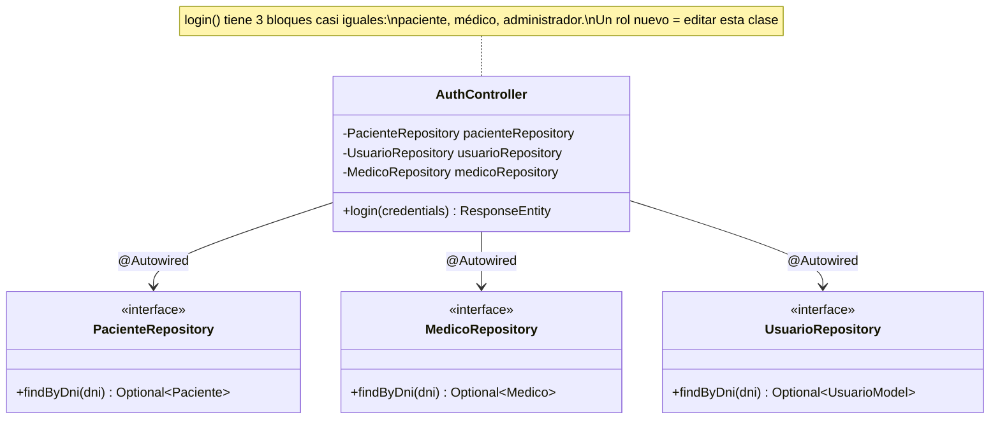
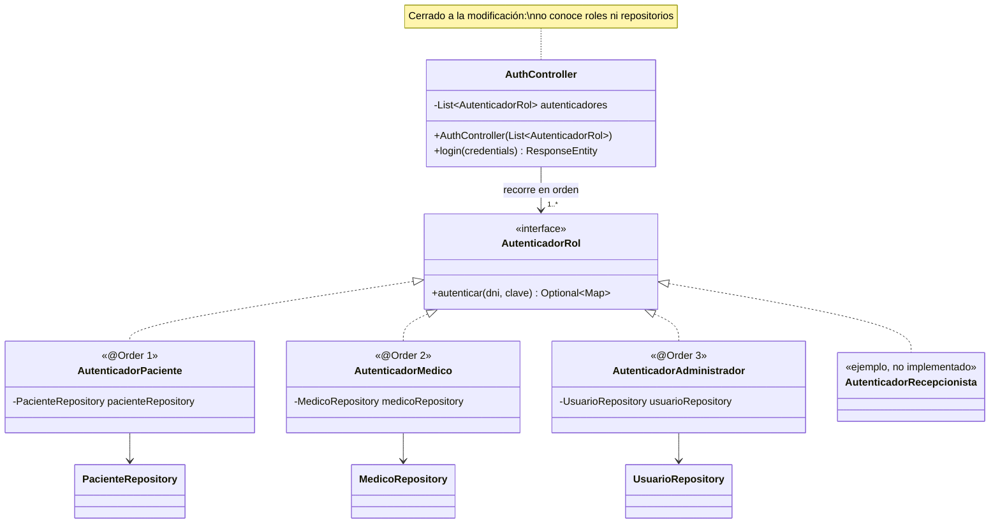

# RFC-007 — R3 Abierto/Cerrado: autenticación extensible por rol

| Campo | Valor |
|---|---|
| **Identificador** | RFC-007 |
| **Fecha de recepción** | 2026-10-21 15:53 |
| **Error conocido asociado** | H-019 — ver `docs/HALLAZGOS.md` |
| **Tipo de cambio** | Normal |
| **Prioridad** | Media |
| **Tipo de mantenimiento** | Preventivo |
| **Solicitante** | Brayan |
| **Gestor del cambio / aprobación** | Comité de control de configuración (Brayan) |
| **Ingeniero asignado** | Claude Code |
| **Línea base de partida** | LB-6 (commit `8d17c28`, tag `LB-6`; el último commit es `4780beb`, que solo agrega documentación) |
| **Línea base resultante** | LB-7 (tag `LB-7`) |
| **Estatus** | Cerrado |

**Regla que enmarca la RFC:** es una refactorización (mantenimiento preventivo). **No cambia el comportamiento.** `POST /login` debe responder lo mismo que en LB-6 (campos, códigos y mensajes) y buscar en el mismo orden: paciente → médico → administrador (comportamiento caracterizado en U40). Todas las pruebas deben dar el mismo resultado que en LB-6.

---

## Principio aplicado: Abierto/Cerrado (OCP, la "O" de SOLID)

**Qué dice, en simple:** una clase debe estar **abierta a la extensión** y **cerrada a la modificación**. Es decir: para agregar un comportamiento nuevo se agrega código nuevo (una clase nueva), sin editar el código que ya funciona y ya está probado. Se consigue haciendo que la clase dependa de una **abstracción** (una interfaz) y no de cada caso concreto.

**El problema aquí (H-019):** `AuthController` tenía tres bloques casi iguales, uno por rol (paciente, médico, administrador). Cada bloque conocía su repositorio, comparaba la clave y armaba la respuesta. Para agregar un rol había que **abrir** `AuthController` y escribir un cuarto bloque: la clase no estaba cerrada a la modificación, y cada edición ponía en riesgo los otros tres roles (que comparten el mismo método y el mismo `try/catch`).

**Cómo se aplicó:**
- Se crea la abstracción `AutenticadorRol` (interfaz con un método, `autenticar(dni, clave)`), que devuelve los datos de la respuesta si el DNI y la clave son de un usuario de ese rol, o vacío si no.
- Cada rol es una clase que implementa la interfaz: `AutenticadorPaciente`, `AutenticadorMedico`, `AutenticadorAdministrador`. Cada una contiene **exactamente** el bloque que antes estaba en el controlador.
- `AuthController` ya no conoce roles ni repositorios: recibe la lista de autenticadores y la recorre; el primero que reconoce las credenciales da la respuesta. Si ninguno, 401.
- El orden se fija con `@Order(1)`, `@Order(2)`, `@Order(3)`: Spring entrega la lista `List<AutenticadorRol>` ordenada por esa anotación. Así el orden paciente → médico → administrador queda declarado en cada autenticador y no en el controlador.

### Demostración: agregar el rol "recepcionista"
Para que una recepcionista pueda iniciar sesión **habría que crear un solo archivo** (no se implementa en esta RFC):

`backend/src/main/java/com/centro_valdiviezo/backend/autenticacion/AutenticadorRecepcionista.java`
```java
@Component
@Order(4) // se busca después del administrador
public class AutenticadorRecepcionista implements AutenticadorRol {
    private final RecepcionistaRepository recepcionistaRepository; // repositorio de la nueva tabla
    // constructor con el repositorio
    @Override
    public Optional<Map<String, Object>> autenticar(String dni, String clave) {
        // buscar por DNI, comparar la clave y armar la respuesta con "tipo": "recepcionista"
    }
}
```
**`AuthController` no cambiaría ni una línea:** Spring encuentra el nuevo `@Component`, lo agrega a la `List<AutenticadorRol>` en la posición que dice `@Order` y el bucle del controlador lo recorre. (La tabla, la entidad y el repositorio de recepcionistas, y la pantalla de login del frontend, serían parte de esa funcionalidad nueva; ninguno es `AuthController`.) La prueba U81 lo comprueba: le pasa al controlador un cuarto autenticador inventado y el controlador lo usa sin modificaciones.

---

## Descripción del cambio

### Motivación (qué pasa hoy)
`AuthController.login` (`AuthController.java:44-92` en LB-6) repite tres veces: buscar por DNI en un repositorio, comprobar `getClave() != null && getClave().equals(clave)` y armar un `HashMap` con `success`, `tipo`, `id`, `nombres`, `apellidos`, `dni` (más `cmp` en médico y `rol` en administrador).

### Propósito (qué debe pasar después)
- Agregar un rol = agregar una clase que implemente `AutenticadorRol`, sin tocar `AuthController`.
- Mismas respuestas: 400 `{"error":"DNI y contraseña son requeridos"}`, 200 con los mismos campos por rol, 401 `{"error":"Credenciales inválidas"}`, 500 `{"error":"Error interno: <mensaje>"}`; mismo orden de búsqueda y mismas consultas a los repositorios.

---

## Diseño

| Elemento | Qué hace |
|---|---|
| `autenticacion/AutenticadorRol.java` (interfaz) | `Optional<Map<String, Object>> autenticar(String dni, String clave)` |
| `autenticacion/AutenticadorPaciente.java` (`@Component @Order(1)`) | Bloque del paciente, igual que en LB-6: `PacienteRepository.findByDni`, clave, respuesta con `tipo: "paciente"` |
| `autenticacion/AutenticadorMedico.java` (`@Component @Order(2)`) | Bloque del médico: `MedicoRepository.findByDni`, respuesta con `tipo: "medico"` y `cmp` |
| `autenticacion/AutenticadorAdministrador.java` (`@Component @Order(3)`) | Bloque del administrador: `UsuarioRepository.findByDni`, respuesta con `tipo: "administrador"` y `rol` |
| `controller/AuthController.java` | Recibe `List<AutenticadorRol>` por constructor (atributo `final`); valida que vengan DNI y clave (400), recorre la lista, 401 si nadie reconoce; el mismo `try/catch` con `e.printStackTrace()` y 500 |

**Detalles que se conservan a propósito:**
- Si el DNI existe en un rol pero la clave no coincide, se sigue buscando en el siguiente (U40). El bucle hace lo mismo que los tres `if` en cascada.
- Una excepción en cualquier repositorio sigue llegando al `catch` del controlador: los autenticadores no atrapan nada.
- Cada respuesta se sigue armando con `HashMap` (las claves no tienen orden garantizado, igual que antes).
- Los autenticadores reciben su repositorio por constructor (atributo `final`), igual que el controlador.

**Paquete nuevo `autenticacion`:** se eligió un paquete propio en lugar de `seguridad/` porque `seguridad/` contiene el código JWT de Spring Security, que hoy está desactivado (H-016) y no participa en `/login`.

### Pruebas nuevas
- **U80** `AutenticadorRolOrdenTest.springEntregaLosAutenticadoresEnOrdenPacienteMedicoAdministrador`: levanta un contexto de Spring mínimo (solo los 3 autenticadores y repositorios simulados) y comprueba que la `List<AutenticadorRol>` que Spring inyecta llega en el orden paciente → médico → administrador. Es la prueba de que `@Order` reproduce el orden de U40 en la aplicación real.
- **U81** `AuthControllerExtensionTest.unRolNuevoSeAgregaSinModificarElControlador`: construye `AuthController` con los 3 autenticadores y uno más, inventado en la prueba; un DNI que solo ese cuarto autenticador reconoce da 200 con su respuesta. Demuestra el principio sin implementar un rol real.

---

## Cambios en pruebas

**Decisión del usuario (2026-10-21 15:52, bitácora):** opción 1 — modificar **solo** las líneas que construyen el objeto bajo prueba, a partir de los **mismos** mocks; ninguna aserción, `verify`, `when/thenReturn`, dato de entrada o nombre de prueba cambia.

**Por qué no va en un commit separado:** la construcción nueva usa `AutenticadorPaciente`, `AutenticadorMedico` y `AutenticadorAdministrador`, que no existen en LB-6; un commit solo con las pruebas no compilaría. Según la condición 2 del usuario, va en el mismo commit que esta RFC y se lista aquí línea por línea.

**Justificación común:** cambió la forma de **construir** la clase (ahora recibe la lista de autenticadores en lugar de los 3 repositorios), no lo que se comprueba. Los autenticadores se construyen con los mismos `@Mock` de repositorio que ya tenía la prueba, en el orden de producción, así que cada `when(...)`, `verify(...)` y `verifyNoInteractions(...)` sigue apuntando a los mismos objetos.

**Diff exacto** (`git diff -U0 -- backend/src/test`, 16:07; el usuario confirmó cada edición cuando la preguntó el hook de pruebas protegidas):

`backend/src/test/java/com/centro_valdiviezo/backend/controller/AuthControllerCaracterizacionTest.java`
```diff
@@ -7,0 +8 @@ import java.util.HashMap;
+import java.util.List;
@@ -10,0 +12 @@ import java.util.Optional;
+import org.junit.jupiter.api.BeforeEach;
@@ -13 +14,0 @@ import org.junit.jupiter.api.extension.ExtendWith;
-import org.mockito.InjectMocks;
@@ -17,0 +19,3 @@ import org.springframework.http.ResponseEntity;
+import com.centro_valdiviezo.backend.autenticacion.AutenticadorAdministrador;
+import com.centro_valdiviezo.backend.autenticacion.AutenticadorMedico;
+import com.centro_valdiviezo.backend.autenticacion.AutenticadorPaciente;
@@ -39 +42,0 @@ class AuthControllerCaracterizacionTest {
-    @InjectMocks
@@ -41,0 +45,8 @@ class AuthControllerCaracterizacionTest {
+    @BeforeEach
+    void construir() {
+        authController = new AuthController(List.of(
+                new AutenticadorPaciente(pacienteRepository),
+                new AutenticadorMedico(medicoRepository),
+                new AutenticadorAdministrador(usuarioRepository)));
+    }
+
```
`backend/src/test/java/com/centro_valdiviezo/backend/controller/AuthControllerTest.java`
```diff
@@ -5,0 +6,3 @@ import static org.junit.jupiter.api.Assertions.*;
+import com.centro_valdiviezo.backend.autenticacion.AutenticadorAdministrador;
+import com.centro_valdiviezo.backend.autenticacion.AutenticadorMedico;
+import com.centro_valdiviezo.backend.autenticacion.AutenticadorPaciente;
@@ -12 +14,0 @@ import org.junit.jupiter.api.Test;
-import org.mockito.InjectMocks;
@@ -17,0 +20 @@ import java.util.HashMap;
+import java.util.List;
@@ -32 +34,0 @@ public class AuthControllerTest {
-    @InjectMocks
@@ -37,0 +40,4 @@ public class AuthControllerTest {
+        authController = new AuthController(List.of(
+                new AutenticadorPaciente(pacienteRepository),
+                new AutenticadorMedico(medicoRepository),
+                new AutenticadorAdministrador(usuarioRepository)));
```

| Línea(s) | Por qué |
|---|---|
| `-@InjectMocks` (ambos archivos) | Mockito armaba `AuthController` con los 3 repositorios; ahora el constructor pide `List<AutenticadorRol>` y Mockito no puede armarla (pasaría `null`). |
| `+authController = new AuthController(List.of(...))` | Construcción explícita con los **mismos** `@Mock`, envueltos en los autenticadores, en el orden de producción (U80 comprueba que Spring usa ese mismo orden). En la de caracterización va en un `@BeforeEach construir()` (como ya hacía `CitaConsultaControllerCaracterizacionTest`); en la vieja, dentro del `setup()` existente, después de `openMocks`. |
| imports `List`, `BeforeEach`, `Autenticador*`; quitado `InjectMocks` | Necesarios para la construcción; `InjectMocks` quedó sin uso. |

**Ninguna** línea con `assert*`, `verify*`, `when(...)`, datos de entrada o nombres de prueba cambió (el diff no tiene otras líneas). U33–U41 y `testLoginMedicoSuccess` pasan sin cambios en lo que comprueban.

---

## Diagrama de clases (UML)

### Antes (LB-6)


### Después (LB-7)


---

## Alternativas evaluadas

| Alternativa | Decisión | Motivo |
|---|---|---|
| Interfaz `AutenticadorRol` + una clase por rol + `List` inyectada y ordenada con `@Order` | **Elegida** | Agregar un rol es agregar una clase; el orden queda declarado en cada autenticador. |
| Mantener los 3 repositorios en `AuthController` y armar los autenticadores dentro | Descartada | Un rol nuevo seguiría obligando a editar `AuthController` (no cumple OCP). Además mantendría las pruebas sin cambios solo por acomodarlas. |
| Un `Map<String, AutenticadorRol>` por tipo | Descartada | El login no sabe de antemano el rol: busca en todos en orden; un mapa no tiene orden. |
| Orden por una lista explícita en una clase de configuración (`@Bean List<AutenticadorRol>`) | Descartada | Un rol nuevo obligaría a editar esa clase; con `@Order` basta con la clase nueva. |
| Una clase base abstracta con el "buscar, comparar clave, armar respuesta" | Descartada en esta RFC | Las 3 entidades no comparten interfaz (`getIdPaciente`, `getId_medico`, `getId`; `getNombres` vs `getNombre`) y cada respuesta tiene campos propios; forzarlo complica sin ganar extensibilidad. Queda una pequeña repetición (buscar + comparar clave) en cada autenticador, aceptada. |
| Corregir H-007 (clave en texto plano) al mover la comparación | Descartada | Es correctivo y cambia el comportamiento. |

---

## Análisis de impacto

### Técnico — archivos
- **Nuevos:** `autenticacion/AutenticadorRol.java`, `AutenticadorPaciente.java`, `AutenticadorMedico.java`, `AutenticadorAdministrador.java`; pruebas `autenticacion/AutenticadorRolOrdenTest.java` (U80) y `controller/AuthControllerExtensionTest.java` (U81).
- **Modificados:** `controller/AuthController.java`; construcción en `AuthControllerCaracterizacionTest.java` y `AuthControllerTest.java` (sección "Cambios en pruebas").
- **Sin cambios:** frontend, base de datos, `WebSecurityConfig`, demás controladores.

### Costo y tiempo estimado
Código: 20 min. Validación (compilación, unitarias, `mvnw test`, P25, Playwright, P01–P24): 40 min. Documentación: 20 min. Costo monetario: ninguno.

### Recursos humanos
Comité (Brayan): aprobación. Ingeniero asignado: Claude Code.

### Riesgo — qué podría romperse y cómo se detectaría
| Riesgo | Cómo se detecta |
|---|---|
| Cambia el orden de búsqueda en la aplicación real | U80 (contexto de Spring), U40; P19 (roles cruzados) |
| Cambian campos, códigos o mensajes de `/login` | U33–U41; P09 (API), P05–P08, P10, P18, P19 |
| Spring no arranca (dependencia sin resolver) | Arranque del backend, `contextLoads` |
| El frontend deja de entrar | Playwright 6/6; P05–P07 |

## Personas afectadas
Desarrolladores (la autenticación está en un paquete nuevo). Usuarios finales: ninguno.

## Plan de implementación
| Orden | Paso | Responsable |
|---|---|---|
| 1 | Registrar la RFC y flujo hasta "Asignado" | Comité / Claude Code |
| 2 | Interfaz, 3 autenticadores, `AuthController`; construcción en las 2 pruebas; U80–U81 | Claude Code |
| 3 | Validación en 5 pasos (ver abajo) | Claude Code |
| 4 | Evaluación, documentación, commit y tag `LB-7` | Claude Code / Comité |

**Los 5 pasos de validación (backend, sin capturas):**
1. Compilación del backend (`./mvnw compile`) sin errores.
2. Pruebas unitarias del backend (`./mvnw test`): las 37 de LB-6 con el mismo resultado, más las nuevas.
3. Reinicio del backend y P25 (CORS) idéntica a LB-6.
4. Playwright desde `e2e/`: 6 passed.
5. BD recargada y batería P01–P24 con los mismos scripts de LB-6; `diff` de las salidas sin las líneas de hora.

## Plan de back-out
- Antes del commit: `git restore --source=HEAD -- backend` y quitar los archivos nuevos con la herramienta de edición.
- Después del commit: `git revert --no-edit <hash del commit RFC-007>`, reiniciar el backend y correr la batería.

---

## Historial de estados

| Fecha y hora | Estado | Qué se hizo |
|---|---|---|
| 2026-10-21 15:53 | Registrado | Se registró la RFC-007 tras revisar `AuthController` y las pruebas que lo construyen. |
| 2026-10-21 15:53 | ¿Solicitud completa? → Sí | Tiene los campos del formato, el diseño, los diagramas, las alternativas y la demostración del rol nuevo. |
| 2026-10-21 15:53 | Investigación preliminar | El cambio obliga a cambiar la construcción en 2 pruebas; el usuario eligió la opción 1 (15:52). |
| 2026-10-21 15:53 | ¿Es correcta? → Sí | No cambia respuestas ni orden; no toca aserciones. |
| 2026-10-21 15:53 | Aprobado | Comité de control de configuración (Brayan), según la solicitud de la tarea 12. |
| 2026-10-21 15:53 | Asignado | Claude Code. |
| 2026-10-21 entre 15:53 y 16:03 (hora exacta sin registro) | En implementación | Interfaz, 3 autenticadores y `AuthController` escritos. Las ediciones de las 2 pruebas fueron rechazadas una vez (el aviso del hook no mostraba la ruta completa); se aplicaron tras la confirmación del usuario. U80 y U81 escritas. |
| 2026-10-21 16:03 | En pruebas | 1) `./mvnw -q compile` (16:03:32–16:03:41) sin errores. 2) Backend detenido (pid 12096, 16:03:46), BD recargada (16:03:53, 21 citas), `./mvnw test` (16:03:54–16:04:10): `Tests run: 39, Failures: 0, Errors: 0, Skipped: 0` · `BUILD SUCCESS`. 3) Backend arrancado (16:04:26, pid 1348); P25 (16:04:28–16:04:33) idéntica a LB-6. 4) Playwright (16:04:38–16:04:48): 6 passed. 5) BD recargada (16:04:56); batería P01–P24 (16:04:57–16:06:32) y, con el backend apagado (16:06:44), P11/P18 (hasta 16:07:00): `diff` contra LB-6 igual. |
| 2026-10-21 16:07 | Cerrado | Evaluación post-implementación completada; H-019 cerrado. El commit y el tag `LB-7` se registran en la bitácora. |

---

## Evaluación post-implementación

### ¿Se cumplieron los objetivos?
Sí, sin cambio de comportamiento:

| Objetivo | Evidencia | LB-6 | LB-7 |
|---|---|---|---|
| Un rol nuevo no modifica `AuthController` (H-019) | Diseño; U81 (cuarto rol inventado, controlador sin cambios) | 3 bloques en el controlador | Interfaz + 1 clase por rol |
| Mismo orden paciente → médico → admin | U40 (sin cambios en sus aserciones); U80 (contexto de Spring) | U40 pasa | U40 y U80 pasan |
| Mismas respuestas de `/login` | U33–U41; P09; P05–P08, P10, P18, P19 | — | iguales |
| Pruebas unitarias del backend | `./mvnw test` | 37/37 | 39/39 (37 + U80, U81) |
| P25 | `diff` con LB-6 | — | idéntica |
| Playwright | `npx playwright test` | 6 passed | 6 passed |
| P01–P24 | `diff` de las salidas de los scripts de LB-6 sin las líneas de hora | 20 PASA · 5 FALLA (con P25) | **iguales** |

Nota sobre el `diff` de la parte "a" de la API: la única diferencia fue la línea `P04 codigo: 500`, que en LB-6 se agregó a mano a la salida (bitácora 15:22–15:24). Se consultó igual en LB-7 (`P04 codigo: 500`) y se agregó a la salida.

### ¿Hubo problemas imprevistos?
- Las ediciones de las pruebas se rechazaron una vez porque el aviso del hook mostraba la ruta cortada; desde entonces la ruta relativa se escribe en el chat antes de cada edición de prueba (pedido del usuario).
- No hubo regresiones.

### ¿Se usó el plan de back-out? ¿Por qué?
No. Los objetivos se cumplieron y no hubo regresiones.
