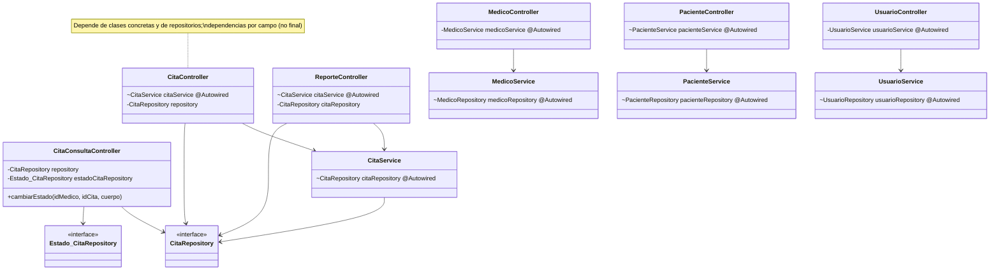
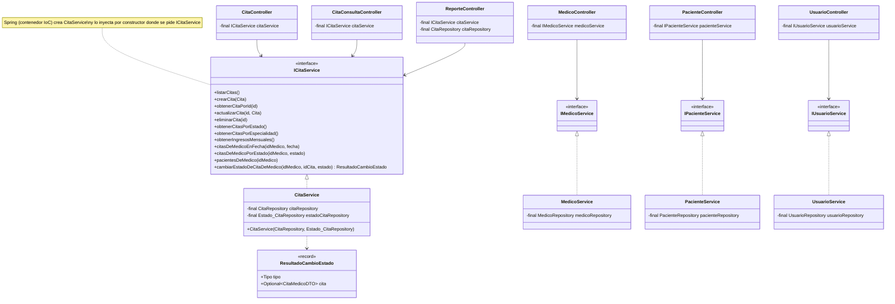

# RFC-008 — R4 Inversión de Control: inyección por constructor e interfaces de servicio

| Campo | Valor |
|---|---|
| **Identificador** | RFC-008 |
| **Fecha de recepción** | 2026-10-21 16:10 |
| **Error conocido asociado** | H-015, H-020 — ver `docs/HALLAZGOS.md` |
| **Tipo de cambio** | Normal |
| **Prioridad** | Media |
| **Tipo de mantenimiento** | Preventivo |
| **Solicitante** | Brayan |
| **Gestor del cambio / aprobación** | Comité de control de configuración (Brayan) |
| **Ingeniero asignado** | Claude Code |
| **Línea base de partida** | LB-7 (commit `267c006`, tag `LB-7`) |
| **Línea base resultante** | LB-8 (tag `LB-8`) |
| **Estatus** | Cerrado |

**Regla que enmarca la RFC:** es una refactorización (mantenimiento preventivo). **No cambia el comportamiento**: ninguna respuesta de la API cambia (rutas, códigos, cuerpos, mensajes). Todas las pruebas deben dar el mismo resultado que en LB-7.

---

## Principio aplicado: Inversión de Control (IoC) e Inversión de Dependencias (DIP, la "D" de SOLID)

**Inversión de Control, en simple:** un objeto **no crea ni busca** las piezas que necesita; se las **entrega** alguien de afuera (el contenedor de Spring). El "control" de armar los objetos se invierte: deja de estar en cada clase y pasa al framework. La forma más clara de hacerlo es la **inyección por constructor**: la clase declara en su constructor qué necesita, y no puede existir sin esas piezas.

**Relación con el ejemplo del curso** — *"refactorización de una aplicación para usar Spring Framework, donde los objetos no crean ni buscan sus dependencias, sino que les son inyectadas usando IoC"*: es exactamente lo que se hace aquí, en tres pasos:
1. **Los objetos no crean ni buscan sus dependencias.** Ningún controlador ni servicio hace `new CitaRepository…` ni pide nada a un registro global; ya era así con `@Autowired`, pero la inyección **por campo** escondía las dependencias (atributos que Spring llena por reflexión después de crear el objeto, que pueden quedar `null` si alguien crea la clase con `new`, y que no pueden ser `final`).
2. **Les son inyectadas usando IoC.** Ahora cada clase recibe sus dependencias **por constructor** y las guarda en atributos `final`. Spring sigue siendo quien las arma y las entrega (el contenedor de IoC), pero el contrato queda escrito en el constructor: es visible, obligatorio e inmutable. Una prueba (o cualquier otro código) puede construir la clase entregándole sus piezas, sin Spring ni reflexión; es lo que ya hacen las pruebas de caracterización.
3. **Lo de alto nivel depende de abstracciones (DIP).** Los controladores (alto nivel: reciben HTTP) dependían de clases concretas (`CitaService`, `MedicoService`…) y, en dos casos, directamente de repositorios (acceso a datos). Ahora dependen de **interfaces** (`ICitaService`, `IMedicoService`, `IPacienteService`, `IUsuarioService`); la implementación concreta la elige Spring. Así se puede cambiar la implementación (por ejemplo, una con caché o una de prueba) sin tocar el controlador.

**Cómo se aplicó:**
- **Inyección por constructor (H-020):** se reemplazan los `@Autowired` sobre atributos por constructores con atributos `final` en los controladores (`CitaController`, `EspecialidadController`, `MedicoController`, `PacienteController`, `ReporteController`, `UsuarioController`; `AuthController` ya quedó así en RFC-007; `CitaConsultaController` ya usaba constructor), en los 4 servicios y en `UserDetailServiceImpl`.
- **Controladores que dependen de servicios, no de repositorios (H-015):** la lógica de `CitaController` y `CitaConsultaController` (que usaban `CitaRepository` y `Estado_CitaRepository`) pasa a `CitaService`.
- **Interfaces de servicio:** `ICitaService`, `IMedicoService`, `IPacienteService`, `IUsuarioService`; las clases `CitaService`, `MedicoService`, `PacienteService`, `UsuarioService` las implementan y los controladores dependen de la interfaz.

---

## Descripción del cambio

### Motivación (qué pasa hoy)
- **H-020:** `grep -rn "@Autowired" backend/src/main` → 12 inyecciones por campo en LB-7 (las 3 de `AuthController` se quitaron en RFC-007): `CitaController:20`, `EspecialidadController:15`, `MedicoController:21`, `PacienteController:19`, `ReporteController:23`, `UsuarioController:21`, `CitaService:17`, `MedicoService:18`, `PacienteService:15`, `UsuarioService:13`, `UserDetailServiceImpl:18,21`. Ningún servicio implementa una interfaz.
- **H-015:** `CitaController` recibe `CitaService` pero hace el CRUD con `CitaRepository`; `CitaConsultaController` usa `CitaRepository` y `Estado_CitaRepository` (incluida la lógica de cambio de estado de RFC-003).
- `EspecialidadController` tenía a la vez `@Autowired` en el campo y un constructor que lo asignaba (la inyección ocurría dos veces).

### Propósito (qué debe pasar después)
- Ningún `@Autowired` sobre atributos; dependencias por constructor y `final`.
- `CitaController` y `CitaConsultaController` solo dependen de `ICitaService`.
- Los controladores dependen de interfaces de servicio.
- Mismas respuestas en todos los endpoints.

---

## Diseño

### Interfaces y su implementación
| Interfaz (nueva, `services/`) | Implementación | La usan |
|---|---|---|
| `ICitaService` | `CitaService` (`@Service`; constructor `(CitaRepository, Estado_CitaRepository)`) | `CitaController`, `CitaConsultaController`, `ReporteController` |
| `IMedicoService` | `MedicoService` (constructor `(MedicoRepository)`) | `MedicoController` |
| `IPacienteService` | `PacienteService` (constructor `(PacienteRepository)`) | `PacienteController` |
| `IUsuarioService` | `UsuarioService` (constructor `(UsuarioRepository)`) | `UsuarioController` |

**Nombres:** la tarea pone como ejemplo `ICitaService` "con su implementación". Se mantiene el nombre actual de la clase (`CitaService`) para la implementación, en lugar de renombrarla a `CitaServiceImpl`: las 3 pruebas de caracterización de servicios declaran `@InjectMocks private CitaService service;` (y `MedicoService`, `PacienteService`); si `CitaService` pasara a ser la interfaz, Mockito no podría instanciarla y habría que cambiar también esas 3 pruebas. Con este nombre, esas pruebas no se tocan.

Cada interfaz declara los métodos públicos que ya tenía la clase (sin cambiar firmas). `ICitaService` agrega los métodos que vienen de los controladores.

### Métodos que pasan a `CitaService` (H-015)
| Método nuevo en `ICitaService` | Viene de | Mismo comportamiento |
|---|---|---|
| `listarCitas()` | `CitaController.obtenerTodos` | `findAll()` |
| `crearCita(Cita)` | `CitaController.crear` | `save(item)` sin validar (H-012 sigue abierto) |
| `obtenerCitaPorId(Integer)` → `Optional<Cita>` | `CitaController.obtenerPorId` | el controlador sigue respondiendo `orElse(null)` (200 con cuerpo vacío) |
| `actualizarCita(Integer, Cita)` → `Optional<Cita>` | `CitaController.actualizar` | copia los mismos 6 campos y guarda; el controlador responde `orElse(null)` |
| `eliminarCita(Integer)` | `CitaController.eliminar` | `deleteById` |
| `citasDeMedicoEnFecha(Integer, String)` | `CitaConsultaController.getCitasPorMedicoYFecha` | `findByMedicoIdAndFecha` |
| `citasDeMedicoPorEstado(Integer, String)` | `CitaConsultaController.getCitasDeMedico` | `findCitasDeMedicoPorEstado` |
| `pacientesDeMedico(Integer)` | `CitaConsultaController.getPacientesDeMedico` | `findPacientesDeMedico` |
| `cambiarEstadoDeCitaDeMedico(Integer idMedico, Integer idCita, String estado)` → `ResultadoCambioEstado` | `CitaConsultaController.cambiarEstado` | Mismas consultas en el mismo orden: `findById`; si la cita no es del médico, termina sin consultar estados; `findByNombreEstado`; `setEstado_cita`; `save`; `findCitaMedicoPorId`. Sin máquina de estados (H-031 sigue abierto) |

`ResultadoCambioEstado` (record nuevo en `services/`) tiene un `Tipo` (`CITA_NO_ENCONTRADA`, `ESTADO_INEXISTENTE`, `CAMBIADO`) y el `Optional<CitaMedicoDTO>` final. **Los códigos y mensajes HTTP se quedan en el controlador** (404 "La cita no existe o no pertenece al médico", 400 "Estado de cita inexistente: …", `ResponseEntity.of(...)`): el servicio no conoce HTTP. Se descartó lanzar excepciones porque `GlobalExceptionHandler` atrapa `RuntimeException` y respondería 500 si alguna escapara.

### Fuera del alcance (se registra, no se toca)
- `ReporteController` y `EspecialidadController` también usan repositorios directamente (`CitaRepository`, `EspecialidadRepository`). La tarea nombra solo `CitaController` y `CitaConsultaController`; aquí solo se cambia su inyección a constructor (y `ReporteController` pasa a depender de `ICitaService` para lo que ya pedía al servicio). Se registra como hallazgo nuevo.
- Los demás controladores que inyectan repositorios por constructor (`CIEController`, `Disponibilidad_MedicoController`, etc.) no tienen `@Autowired` y no están en el alcance de la tarea.

### Pruebas nuevas
- **U82** `CitaServiceCambioEstadoTest`: `cambiarEstadoDeCitaDeMedico` devuelve `CITA_NO_ENCONTRADA` (cita ajena e inexistente, sin consultar estados ni guardar), `ESTADO_INEXISTENTE` (sin guardar) y `CAMBIADO` con el DTO.
- **U83** `CitaServiceCrudTest`: `listarCitas`, `crearCita`, `obtenerCitaPorId`, `actualizarCita` (copia los 6 campos; vacío si no existe, sin guardar), `eliminarCita` y las 3 consultas del médico delegan en el repositorio.
- **U84** `InyeccionPorConstructorTest`: por reflexión, ninguna clase de `controller/`, `services/` ni `UserDetailServiceImpl` tiene atributos con `@Autowired`, todos sus atributos de instancia son `final`, ningún controlador depende de una clase de servicio concreta (solo de interfaces) y `CitaController`/`CitaConsultaController` no tienen atributos de tipo repositorio. (3 métodos de prueba.)

---

## Cambios en pruebas

**Decisión del usuario (2026-10-21 15:52 y confirmación posterior, bitácora):** modificar **solo** la construcción del objeto bajo prueba en `CitaConsultaControllerCaracterizacionTest.java`, a partir de los **mismos** mocks.

**Por qué no va en un commit separado:** la construcción nueva pasa al controlador un `CitaService` armado con los 2 repositorios; en LB-7 `CitaService` no tiene ese constructor y `CitaConsultaController` no acepta un servicio, así que un commit solo con la prueba no compilaría. Va en el mismo commit que esta RFC.

**Diff exacto** (`git diff -U0 -- backend/src/test`, 16:18; antes de la edición se escribió la ruta en el chat, como pidió el usuario):

`backend/src/test/java/com/centro_valdiviezo/backend/controller/CitaConsultaControllerCaracterizacionTest.java`
```diff
@@ -24,0 +25 @@ import com.centro_valdiviezo.backend.repository.Estado_CitaRepository;
+import com.centro_valdiviezo.backend.services.CitaService;
@@ -41 +42 @@ class CitaConsultaControllerCaracterizacionTest {
-        controller = new CitaConsultaController(citaRepository, estadoCitaRepository);
+        controller = new CitaConsultaController(new CitaService(citaRepository, estadoCitaRepository));
```

| Línea | Por qué |
|---|---|
| `new CitaConsultaController(new CitaService(citaRepository, estadoCitaRepository))` | El controlador ya no recibe los 2 repositorios sino `ICitaService`. Se le entrega la implementación real (`CitaService`) armada con los **mismos** 2 `@Mock`, así que cada `when(...)` y `verify(...)` de U42–U46 sigue apuntando a los mismos objetos y la lógica probada es la misma (ahora vive en el servicio). |
| `import …services.CitaService` | Necesario para la construcción. |

**Ninguna** aserción, `verify`, `when/thenReturn`, dato de entrada ni nombre de prueba cambió. U42–U46 pasan.

**Pruebas que NO se tocaron y siguen pasando:** `CitaServiceCaracterizacionTest`, `MedicoServiceCaracterizacionTest`, `PacienteServiceCaracterizacionTest` (`@InjectMocks` sobre la clase concreta). Mockito usa el constructor nuevo y resuelve el repositorio por tipo; en `CitaService`, el segundo parámetro (`Estado_CitaRepository`) no tiene `@Mock` en esa prueba y Mockito pasa `null`, lo que no afecta porque U60–U62 no usan estados (resultado: 3/3).

---

## Diagrama de clases (UML)

### Antes (LB-7)


### Después (LB-8)


---

## Alternativas evaluadas

| Alternativa | Decisión | Motivo |
|---|---|---|
| Interfaces `I…Service` + implementación con el nombre actual + inyección por constructor | **Elegida** | DIP e IoC sin cambiar las pruebas de caracterización de servicios. |
| Renombrar las implementaciones a `…ServiceImpl` y usar `CitaService` como interfaz | Descartada | Obliga a cambiar la construcción en 3 pruebas de caracterización más (`@InjectMocks` sobre una interfaz no funciona). |
| Un servicio nuevo `CitaMedicoService` para lo de `CitaConsultaController` | Descartada | La tarea pide pasar esa lógica a `CitaService`. |
| Que el servicio lance excepciones (404/400) en el cambio de estado | Descartada | `GlobalExceptionHandler` convierte toda `RuntimeException` en 500 si se escapa; un resultado explícito no depende de eso. |
| Que el servicio devuelva `ResponseEntity` | Descartada | Mezcla HTTP en la capa de servicio (lo contrario de lo que busca H-015). |
| Mover también `ReporteController` y `EspecialidadController` a servicios | Descartada en esta RFC | Fuera del alcance pedido; se registra como hallazgo. |
| Inyección por setter | Descartada | Permite objetos incompletos y atributos no `final`. |

---

## Análisis de impacto

### Técnico — archivos
- **Nuevos:** `services/ICitaService.java`, `IMedicoService.java`, `IPacienteService.java`, `IUsuarioService.java`, `ResultadoCambioEstado.java`; pruebas U82–U84.
- **Modificados:** `CitaController`, `CitaConsultaController`, `EspecialidadController`, `MedicoController`, `PacienteController`, `ReporteController`, `UsuarioController`; `CitaService`, `MedicoService`, `PacienteService`, `UsuarioService`; `seguridad/UserDetailServiceImpl`. Construcción en `CitaConsultaControllerCaracterizacionTest.java` (sección "Cambios en pruebas").
- **Sin cambios:** frontend, base de datos, repositorios, modelos, DTO, `AuthController` y autenticadores (RFC-007).

### Costo y tiempo estimado
Código: 30 min. Validación: 40 min. Documentación: 20 min. Costo monetario: ninguno.

### Recursos humanos
Comité (Brayan): aprobación. Ingeniero asignado: Claude Code.

### Riesgo — qué podría romperse y cómo se detectaría
| Riesgo | Cómo se detecta |
|---|---|
| Cambia una respuesta de `/api/cita` o `/api/citas/...` | U42–U46, U82, U83; P01–P03, P12–P16, P20–P24 |
| Spring no puede inyectar una interfaz (dos implementaciones, ciclo) | Arranque del backend; `contextLoads` |
| `@InjectMocks` de las pruebas de servicios deja de construir `CitaService` (nuevo parámetro) | `./mvnw test` (U60–U62) |
| Reportes cambian | P02; Playwright `admin-reportes.spec.ts` |

## Personas afectadas
Desarrolladores. Usuarios finales: ninguno.

## Plan de implementación
| Orden | Paso | Responsable |
|---|---|---|
| 1 | Registrar la RFC y flujo hasta "Asignado" | Comité / Claude Code |
| 2 | Interfaces, servicios por constructor, lógica de citas a `CitaService`, controladores por constructor; construcción en la prueba; U82–U84 | Claude Code |
| 3 | Validación en 5 pasos (igual que RFC-007) | Claude Code |
| 4 | Evaluación, documentación, commit y tag `LB-8` | Claude Code / Comité |

## Plan de back-out
- Antes del commit: `git restore --source=HEAD -- backend` y quitar los archivos nuevos con la herramienta de edición.
- Después del commit: `git revert --no-edit <hash del commit RFC-008>`, reiniciar el backend y correr la batería.

---

## Historial de estados

| Fecha y hora | Estado | Qué se hizo |
|---|---|---|
| 2026-10-21 16:10 | Registrado | Se registró la RFC-008 tras revisar los 12 `@Autowired`, `CitaController`, `CitaConsultaController` y las pruebas que construyen esas clases. |
| 2026-10-21 16:10 | ¿Solicitud completa? → Sí | Campos del formato, diseño, diagramas, alternativas y "Principio aplicado" con el ejemplo del curso. |
| 2026-10-21 16:10 | Investigación preliminar | Solo `CitaConsultaControllerCaracterizacionTest` cambia su construcción (decisión del usuario). Las pruebas de servicios se mantienen gracias al nombre de las implementaciones. |
| 2026-10-21 16:10 | ¿Es correcta? → Sí | No cambia respuestas; no toca aserciones. |
| 2026-10-21 16:10 | Aprobado | Comité de control de configuración (Brayan), según la solicitud de la tarea 12. |
| 2026-10-21 16:10 | Asignado | Claude Code. |
| 2026-10-21 entre 16:10 y 16:14 (hora exacta sin registro) | En implementación | Interfaces, `ResultadoCambioEstado`, servicios y controladores por constructor, lógica de citas en `CitaService`, construcción en la prueba, U82–U84. |
| 2026-10-21 16:14 | En pruebas | 1) `./mvnw -q compile` (16:14:54–16:15:02) sin errores; `grep -rn "@Autowired" src/main` → sin resultados. 2) Backend detenido (pid 2624, 16:15:07), BD recargada (16:15:13), `./mvnw test` (16:15:14–16:15:30): `Tests run: 50, Failures: 0, Errors: 0, Skipped: 0` · `BUILD SUCCESS`; frontend `TOTAL: 32 SUCCESS` (16:18:28–16:18:36) y `TOTAL: 49 SUCCESS` (hasta 16:18:42). 3) Backend arrancado (16:15:49, pid 17596); P25 (16:15:50–16:15:55) idéntica a LB-7. 4) Playwright (16:16:00–16:16:11): 6 passed. 5) BD recargada (16:16:18); P01–P24 (16:16:19–16:17:54) y P11/P18 con el backend apagado (16:18:02–16:18:18): `diff` contra LB-7 igual en todas las salidas. Backend reiniciado (16:18:37, pid 22092). |

---

## Evaluación post-implementación

### ¿Se cumplieron los objetivos?
Sí, sin cambio de comportamiento:

| Objetivo | Evidencia | LB-7 | LB-8 |
|---|---|---|---|
| Sin `@Autowired` en atributos (H-020) | `grep -rn "@Autowired" backend/src/main` → vacío; U84 | 12 | 0; atributos `final` |
| Controladores de citas sin repositorios (H-015) | U84; `CitaController`, `CitaConsultaController` solo tienen `ICitaService` | usaban `CitaRepository` / `Estado_CitaRepository` | la lógica está en `CitaService` (U82, U83) |
| Controladores dependen de interfaces | U84 | dependían de `CitaService`, `MedicoService`… | `ICitaService`, `IMedicoService`, `IPacienteService`, `IUsuarioService` |
| Mismas respuestas | U42–U46 (sin cambiar aserciones), P01–P25, Playwright | — | **iguales** |
| Pruebas del backend | `./mvnw test` | 39/39 | 50/50 (39 + U82 ×4, U83 ×4, U84 ×3) |

### ¿Hubo problemas imprevistos?
- No hubo regresiones.
- Quedan fuera del alcance `ReporteController` (usa `CitaRepository` para el tablero y el resumen) y `EspecialidadController` (usa `EspecialidadRepository`): siguen dependiendo de repositorios, ahora por constructor. Se registró H-039.
- La batería no ejercita `PUT`/`DELETE /api/cita/{id}` ni `GET /api/cita/{id}` con un ID inexistente. Esos caminos los cubre U83 (mismas operaciones de repositorio y el mismo `orElse(null)` en el controlador) pero no se compararon por HTTP contra LB-7.

### ¿Se usó el plan de back-out? ¿Por qué?
No. Los objetivos se cumplieron y no hubo regresiones.
